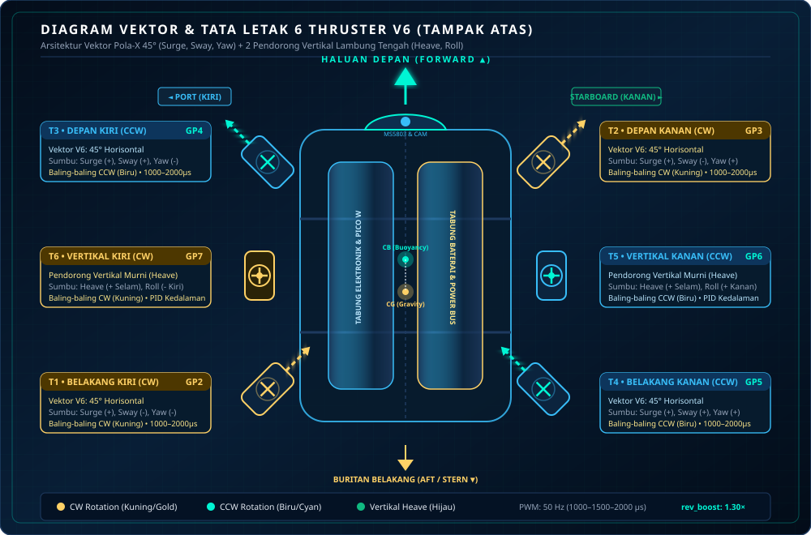
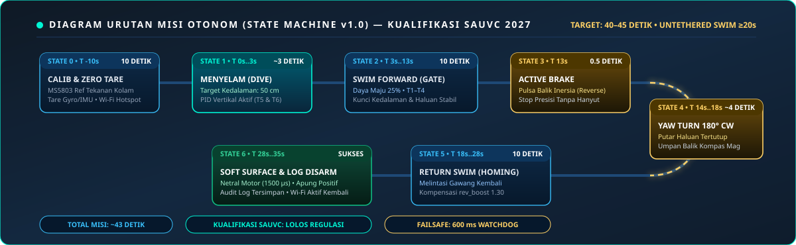

# PANDUAN LENGKAP PENGOPERASIAN WEB TERMINAL & FIRMWARE AUV SAUVAC (SAUVC 2027)
**Standar Operasional Prosedur (SOP), Tata Kelola Unified CLI Engine v1.0, dan Rekayasa Misi Otonom**  
*Tim Robotika AUV SAUVAC — Jurusan Teknik Elektro, Fakultas Sains dan Teknik, Universitas Bangka Belitung*

<p align="center">
  
</p>

---

## DAFTAR ISI
1. [Arsitektur Sistem & Spesifikasi Hardware](#1-arsitektur-sistem-spesifikasi-hardware)
2. [Panduan Koneksi & Antarmuka Akses](#2-panduan-koneksi-antarmuka-akses)
3. [Kamus Lengkap Perintah Terminal (Unified CLI Engine v1.0)](#3-kamus-lengkap-perintah-terminal-unified-cli-engine-v10)
4. [Standar Operasional Prosedur (SOP) Lapangan & Video Kualifikasi SAUVC 2027](#4-standar-operasional-prosedur-sop-lapangan-video-kualifikasi-sauvc-2027)
5. [Solusi Masalah Putaran Motor Loyo di Arah Minus (rev_boost)](#5-solusi-masalah-putaran-motor-loyo-di-arah-minus-rev-boost)
6. [Panduan Uji Coba Meja / Kamar Lab (sim on)](#6-panduan-uji-coba-meja-kamar-lab-sim-on)
7. [Panduan Flash Firmware Nirkabel (OTA - Over The Air)](#7-panduan-flash-firmware-nirkabel-ota---over-the-air)
8. [Troubleshooting & Frequently Asked Questions (FAQ)](#8-troubleshooting-frequently-asked-questions-faq)

---

## 1. Arsitektur Sistem & Spesifikasi Hardware

Robot Selam Otonom (*Autonomous Underwater Vehicle* - AUV) SAUVAC UBB dikendalikan oleh mikrokontroler **Raspberry Pi Pico W (RP2040 Dual-Core ARM Cortex-M0+ @ 133 MHz)** yang menjalankan arsitektur pemrosesan paralel asinkron dengan pemisahan tugas inti (*core separation*) yang ketat.

### 1.1 Pembagian Beban Komputasi Dual-Core RP2040
```text
┌────────────────────────────────────────────────────────────────────────┐
│                        RP2040 CORE 0 (Utama)                           │
│  - Web Terminal Server HTTP Port 80 (REST API & Command Console)       │
│  - Unified CLI Engine (Parser baris perintah Serial USB & Web)         │
│  - Ring-Buffer Event Logger (80 entri riwayat audit dengan timestamp)  │
│  - Finite State Machine Misi Otonom SAUVC (Dive -> Cruise -> Turn)     │
│  - Watchdog Keselamatan & Heartbeat Failsafe (Batas 600 ms)            │
│  - Matriks Mixer Kendali 6-DOF (Surge, Sway, Heave, Yaw, Pitch, Roll)  │
│  - Pembangkit Pulsa PWM Servo Hardware (50 Hz, GP2 s.d. GP7)           │
│  - Layanan Pembaruan Firmware Nirkabel (OTA Flasher via /update)       │
└────────────────────────────────────────────────────────────────────────┘
                                    │
       [ Snapshot Data Mutex & Atomics Non-Blocking Memory Order ]
                                    │
┌────────────────────────────────────────────────────────────────────────┐
│                        RP2040 CORE 1 (Sensor)                          │
│  - Polling Sensor I2C1 (Wire1: GP26 SDA / GP27 SCL) setiap 50 ms       │
│  - Pembacaan Sensor Tekanan MS5803-14BA (Kedalaman air presisi mm)     │
│  - Filter Digital Moving Average (Peredam riak gelombang permukaan)    │
│  - Pembacaan IMU 6-DOF MPU-6050 & Filter Komplementer Orientasi Sudut  │
│  - Kompas Magnetik HMC5883L/QMC5883L & Koreksi Deklinasi Magnetik      │
│  - Thread Watchdog & Auto-Reconnect Otomatis jika Bus I2C Mengalami Noise
└────────────────────────────────────────────────────────────────────────┘
```

> **Keunggulan Arsitektur:** Pemisahan ini menjamin transmisi Wi-Fi atau komputasi state machine pada Core 0 tidak akan pernah menghambat laju pembacaan sensor pada Core 1. Selain itu, pembacaan tegangan ADC3 (VSYS) telah diisolasi dari komunikasi SPI Wi-Fi CYW43439 sehingga sinyal telemetri bebas dari benturan (*lockup*).

---

### 1.1b Konstruksi Mekanis & Material Fisik Non-Aluminium
AUV SAUVAC mengadopsi rancang bangun fisik modular **tanpa menggunakan rangka aluminium (*no aluminum frame*)** guna mencegah korosi elektrolisis di lingkungan perairan dan mengeliminasi interferensi medan magnet liar terhadap sensor kompas digital. Struktur fisik robot terdiri dari:
1. **Plat Akrilik Bening (*Cast Acrylic Plates*)**: Sebagai pelat dinding struktural, dudukan modul thruster, dan penahan benturan dasar kolam.
2. **Batang Pipa Struktural (*Structural Pipe Rods/Tubes*)**: Menghubungkan seluruh pelat akrilik menghasilkan kerangka kaku (*rigid skeleton*) yang ringan dan berdaya apung alami.
3. **Kotak Kompartemen Kedap Air (*Waterproof Module Enclosure Boxes*)**: Kotak terisolasi bersertifikasi kedap air IP68 yang memisahkan baterai daya, instrumentasi sensor, dan sistem komputasi (Raspberry Pi Pico W & Raspberry Pi 5 Companion Computer).

---

### 1.2 Layout 6 Thruster V6 (Tampak Atas)

<p align="center">
  
</p>
<p align="center"><em>Gambar: Diagram Vektor Dinamis & Tata Letak Fisik 6 Thruster V6</em></p>

AUV SAUVAC menggunakan konfigurasi 6 unit pendorong *brushless* kedap air: 4 pendorong horizontal dalam formasi vektor X (*vectored thrust*) dan 2 pendorong vertikal simetris di lambung tengah:

```text
                             ▲ HALUAN / DEPAN (Forward)
                             │
               [T3] ─────────────────── [T2]
            Depan Kiri               Depan Kanan
             CCW (Biru)              CW (Kuning)
             GPIO GP4                 GPIO GP3
                             │
               [T6] ─────────────────── [T5]
            Tengah Kiri              Tengah Kanan
             (Vertikal)              (Vertikal)
            CCW (Hijau)              CW (Hijau)
             GPIO GP7                 GPIO GP6
                             │
               [T1] ─────────────────── [T4]
           Belakang Kiri            Belakang Kanan
            CW (Kuning)              CCW (Biru)
             GPIO GP2                 GPIO GP5
                             │
                             ▼ BURITAN / BELAKANG
```

#### Tabel Konfigurasi Jalur GPIO & Arah Putaran Default
| Motor | Posisi Fisik | GPIO | Orientasi | Pulsa Netral | Pulsa Min - Max | Kontribusi Sumbu Gerakan |
| :---: | :--- | :---: | :---: | :---: | :---: | :--- |
| **T1** | Belakang Kiri | **GP2** | CW (Kuning) | 1500 µs | 1000 – 2000 µs | Surge (+), Sway (-), Yaw (-) |
| **T2** | Depan Kanan | **GP3** | CW (Kuning) | 1500 µs | 1000 – 2000 µs | Surge (+), Sway (-), Yaw (+) |
| **T3** | Depan Kiri | **GP4** | CCW (Biru) | 1500 µs | 1000 – 2000 µs | Surge (+), Sway (+), Yaw (-) |
| **T4** | Belakang Kanan| **GP5** | CCW (Biru) | 1500 µs | 1000 – 2000 µs | Surge (+), Sway (+), Yaw (+) |
| **T5** | Vertikal Kanan| **GP6** | CW (Hijau) | 1500 µs | 1000 – 2000 µs | Heave (+ Menyelam), Roll (+ Kanan Turun) |
| **T6** | Vertikal Kiri | **GP7** | CCW (Hijau)| 1500 µs | 1000 – 2000 µs | Heave (+ Menyelam), Roll (- Kiri Turun) |

---

### 1.3 Alokasi Pinout Lengkap & Bus Sensor I2C1
| Jalur Perangkat | Label Pin Pico W | Pin Fisik Board | Keterangan & Level Logika |
| :--- | :---: | :---: | :--- |
| **PWM Thruster T1** | GP2 | Pin 4 | Output Sinyal ESC (3.3V Logic, 50 Hz) |
| **PWM Thruster T2** | GP3 | Pin 5 | Output Sinyal ESC (3.3V Logic, 50 Hz) |
| **PWM Thruster T3** | GP4 | Pin 6 | Output Sinyal ESC (3.3V Logic, 50 Hz) |
| **PWM Thruster T4** | GP5 | Pin 7 | Output Sinyal ESC (3.3V Logic, 50 Hz) |
| **PWM Thruster T5** | GP6 | Pin 9 | Output Sinyal ESC (3.3V Logic, 50 Hz) |
| **PWM Thruster T6** | GP7 | Pin 10 | Output Sinyal ESC (3.3V Logic, 50 Hz) |
| **I2C1 Data (SDA)**| GP26 | Pin 31 | Bus Sensor Bersama Wire1 (3.3V Pull-Up) |
| **I2C1 Clock (SCL)**| GP27 | Pin 32 | Bus Sensor Bersama Wire1 (3.3V Pull-Up) |
| **VCC Sensor** | 3V3 OUT | Pin 36 | Catu daya modul sensor (Maksimal 3.3V, dilarang 5V!) |
| **GND Common** | GND | Pin 3, 8, 13, 18, 23, 28, 38 | Titik Ground bersama Pico W, ESC, dan Sensor |
| **Tegangan Logika**| VSYS | Pin 39 | Input 5.0V dari regulator Buck internal robot |

#### Alamat Sensor I2C pada Bus Wire1
1. **MS5803-14BA (Tekanan Air & Kedalaman):** Alamat I2C `0x76` (Alamat alternatif `0x77`).
2. **MPU-6050 (Akselerometer & Giroskop 6-DOF):** Alamat I2C `0x68` (Alamat alternatif `0x69`).
3. **HMC5883L / QMC5883L (Kompas Magnetometer 3-Sumbu):** Alamat I2C `0x1E` (HMC) atau `0x0D` (QMC).

---

### 1.4 Sistem Kelistrikan & Hardware Emergency Kill Switch
Sesuai dengan regulasi keselamatan **SAUVC 2027**:
1. **Sakelar Pemutus Fisik (*Hardware Kill Switch*):** Dipasang di bagian luar atas robot yang mudah diakses penyelam/juri. Sakelar ini memutus kutub positif utama baterai LiPo/Li-Ion secara mekanis.
2. **Uji Bawah Air (*Submerged Kill Test*):** Saat robot melaju di dalam air, mencabut/menekan tombol kill switch seketika mematikan seluruh daya ke ESC dan motor; putaran baling-baling langsung berhenti total tanpa keterlambatan software.
3. **Pemisahan Jalur Daya (*Galvanic & Noise Isolation*):** Arus besar motor disalurkan langsung dari baterai melalui *fuse* utama ke busbar ESC. Daya logika mikrokontroler diturunkan menggunakan regulator switching efisiensi tinggi (Buck Converter 5V) ber-filter LC menuju kaki VSYS.

---

## 2. Panduan Koneksi & Antarmuka Akses

Firmware AUV SAUVAC v1.0 menyediakan dua kanal komunikasi yang bekerja **100% identik dan simultan**: melalui Wi-Fi Web Terminal dan USB Serial Monitor.

### 2.1 Akses Nirkabel (Wi-Fi SoftAP)
Pico W secara mandiri memancarkan jaringan hotspot Access Point tanpa memerlukan router eksternal:
- **SSID Jaringan:** `AUV_UBB_JUARA`
- **Password Wi-Fi:** `ubbjuara2027`
- **Tipe Enkripsi:** WPA2-PSK
- **Alamat IP Statis:** `192.168.4.1`
- **Gateway / Netmask:** `192.168.4.1` / `255.255.255.0`
- **Protokol:** HTTP Port 80

#### Prosedur Menghubungkan Laptop / Smartphone ke Web Terminal:
1. Nyalakan daya AUV via sakelar utama. Tunggu ~2 detik hingga lampu LED Pico W berkedip menandakan hotspot aktif.
2. Pada perangkat laptop atau tablet, pindai jaringan Wi-Fi dan hubungkan ke SSID **`AUV_UBB_JUARA`**.
3. Masukkan password **`ubbjuara2027`**.
4. Buka peramban modern (*Google Chrome*, *Mozilla Firefox*, *Microsoft Edge*, atau *Safari*).
5. Masukkan alamat URL: **`http://192.168.4.1`**.
6. Halaman Web Terminal akan langsung terbuka secara otomatis tanpa perlu memasukkan username atau password web tambahan (keamanan akses sepenuhnya dilindungi oleh enkripsi Wi-Fi WPA2-PSK).

---

### 2.2 Tampilan & Fitur Web Terminal
Halaman Web Terminal dirancang dalam tata letak *single-screen* modern berlatar gelap (*dark mode*) yang sangat ringan dan responsif:

```text
┌────────────────────────────────────────────────────────────────────────┐
│  ⚓ AUV SAUVAC TERMINAL · UBB JUARA               ● CONNECTED (192.168.4.1)│
├────────────────────────────────────────────────────────────────────────┤
│ DEPTH: 50.2 cm │ HEADING: 088° │ ROLL: +0.4° │ PITCH: -0.2° │ PWR: 25% │
├────────────────────────────────────────────────────────────────────────┤
│ [RUN MISSION]   [STOP DARURAT]   [CALIB ZERO]   [DOWNLOAD AUDIT LOG]   │
├────────────────────────────────────────────────────────────────────────┤
│ [00:00:10.024] [STATE] [AUTO] Phase: DIVE -> Target Depth 50 cm        │
│ [00:00:12.431] [STATE] [AUTO] Depth 50.1 cm reached. Stabilizing 2s...  │
│ [00:00:14.432] [STATE] [AUTO] Phase: SWIM -> Cruise 10s Power 25%       │
│ [00:00:18.105] [CMD]   [WEB] status                                    │
│ [00:00:18.110] [INFO]  [SYS] Armed: ARMED | Sim: OFF | Battery: 5.02V  │
│                                                                        │
│ > _ [Ketik perintah di sini, misal: run, stop, depth 60, status]       │
├────────────────────────────────────────────────────────────────────────┤
│ 📦 FIRMWARE FLASH (OTA): [Pilih Berkas firmware.bin]  [UPLOAD & FLASH] │
└────────────────────────────────────────────────────────────────────────┘
```

1. **Telemetry Bar (Atas):** Menampilkan pembaruan data real-time setiap 250 ms: kedalaman air (cm), sudut haluan kompas (*heading*), kemiringan (*roll/pitch*), dan persentase batas daya maksimum.
2. **Quick Action Buttons:**
   - **`[RUN MISSION]`**: Menjalankan misi otonom seketika.
   - **`[STOP DARURAT]`**: Membatalkan misi dan menetralkan seluruh thruster (1500 µs).
   - **`[CALIB ZERO]`**: Menolkan referensi tekanan sensor MS5803 di permukaan air.
   - **`[DOWNLOAD AUDIT LOG]`**: Mengunduh seluruh riwayat ring-buffer log sebagai berkas teks `.txt` untuk evaluasi dewan juri/tim.
3. **Console Terminal (Tengah):** Jendela hitam bergaya terminal UNIX dengan pewarnaan level log (Hijau = INFO, Kuning = WARN, Merah = ERROR, Biru muda = STATE, Ungu = CMD). Dilengkapi fitur riwayat tombol panah atas/bawah (*command history*).
4. **OTA Firmware Flasher (Bawah):** Memungkinkan pengunggahan berkas biner kompilasi PlatformIO langsung ke memori Flash Pico W melalui jaringan nirkabel.

---

### 2.3 Akses USB Serial Monitor
Jika robot sedang diuji di meja kerja dengan kabel USB micro terhubung ke laptop:
- **Baudrate:** `115200`
- **Data Bits:** 8
- **Parity:** None
- **Stop Bits:** 1
- **Line Ending:** Wajib menggunakan **Carriage Return + Line Feed (`CR/LF` atau `\r\n`)**
- **Perangkat Lunak:** PlatformIO Serial Monitor (`pio device monitor`), Arduino IDE Serial Monitor, PuTTY, atau Tera Term.

---

## 3. Kamus Lengkap Perintah Terminal (Unified CLI Engine v1.0)

Sistem parsing baris perintah v1.0 dirancang sangat fleksibel:
- **Format Kanonik:** `set <parameter> <nilai>`
- **Format Pintas (Direct Shortcut):** `<parameter> <nilai>`
- **Format Pembacaan Nilai:** `<parameter>` atau `get <parameter>`
- **Case-Insensitive:** Tidak membedakan huruf besar maupun kecil (misal `STATUS`, `Status`, dan `status` bekerja sama).

---

### 3.1 Parameter Misi & Navigasi Otonom

| Perintah | Deskripsi Fungsi | Rentang Nilai | Nilai Default | Contoh Penggunaan |
| :--- | :--- | :---: | :---: | :--- |
| **`run`** | Memulai eksekusi urutan misi otonom SAUVC. | - | - | `run` |
| **`stop`** | Pembatalan darurat seketika, netralkan seluruh motor ke 1500 µs. | - | - | `stop` |
| **`autorun <on/off>`** | Mengaktifkan/mematikan peluncuran otomatis setelah boot 10 detik. | `on`, `off` / `1`, `0` | `off` | `autorun on`<br>`autorun off` |
| **`depth <cm>`** | Target kedalaman penyelaman robot. | 0 – 500 cm | **50 cm** | `depth 60`<br>`set depth 50` |
| **`swim <sec>`** | Durasi pelayaran lurus tahap maju dan kembali. | 1 – 120 detik | **10 detik** | `swim 12`<br>`set swim 10` |
| **`swim_power <%>`** | Persentase daya motor horizontal saat meluncur lurus. | 5 – 100 % | **25 %** | `swim_power 30`<br>`set swim_power 25` |
| **`turn_angle <deg>`**| Sudut target putar balik di ujung lintasan. | 0 – 360 derajat | **180 derajat** | `turn_angle 180`<br>`set turn_angle 90` |
| **`turn_dir <cw/ccw>`**| Arah orientasi putar balik (*Clockwise* atau *Counter-Clockwise*). | `cw`, `ccw` | **`cw`** | `turn_dir cw`<br>`set turn_dir ccw` |
| **`turn_power <%>`** | Persentase daya dorong motor saat bermanuver putar. | 5 – 100 % | **20 %** | `turn_power 20`<br>`set turn_power 15` |
| **`start_delay <sec>`**| Waktu hitung mundur hening sebelum robot mulai menyelam. | 0 – 30 detik | **3 detik** | `start_delay 3`<br>`set start_delay 5` |
| **`settle_time <sec>`**| Waktu jeda stabilisasi kedalaman sebelum mulai berenang maju. | 0 – 30 detik | **2 detik** | `settle_time 2`<br>`set settle_time 3` |
| **`depth_tol <cm>`** | Toleransi batas atas-bawah kedalaman target tercapai. | 1 – 20 cm | **2 cm** | `depth_tol 3`<br>`set depth_tol 2` |
| **`yaw_tol <deg>`** | Toleransi batas sudut hadap haluan target tercapai. | 1 – 30 derajat | **3 derajat** | `yaw_tol 3`<br>`set yaw_tol 5` |
| **`mission <mode>`** | Profil misi yang diuji: `full`, `gate`, `dive_only`, `turn_only`. | Pilihan nama | **`full`** | `mission gate`<br>`set mission full` |

---

### 3.2 Batas Keamanan & Failsafe Sistem

| Perintah | Deskripsi Fungsi | Rentang Nilai | Nilai Default | Contoh Penggunaan |
| :--- | :--- | :---: | :---: | :--- |
| **`power <%>`** | Batas plafon daya keluaran maksimum seluruh thruster. | 5 – 100 % | **25 %** (Aman) | `power 30`<br>`set power 25` |
| **`ramp <%/s>`** | Pembatas laju akselerasi tenaga motor per detik (*anti-brownout*). | 5 – 100 %/s | **40 %/s** | `ramp 40`<br>`set ramp 50` |
| **`max_depth <cm>`** | Batas penyelaman maksimum absolut; jika tembus = darurat stop. | 10 – 500 cm | **120 cm** | `max_depth 120`<br>`set max_depth 150` |
| **`max_tilt <deg>`** | Batas kemiringan roll/pitch aman robot (*anti-inversion/terbalik*). | 10 – 85 derajat | **50 derajat** | `max_tilt 50`<br>`set max_tilt 45` |
| **`timeout <sec>`** | Waktu henti darurat jika keseluruhan misi melewati durasi ini. | 5 – 300 detik | **60 detik** | `timeout 60`<br>`set timeout 45` |
| **`stall_check <on/off>`**| Deteksi robot macet/terhalang (kedalaman/posisi tidak berubah). | `on`, `off` | **`on`** | `stall_check on`<br>`set stall_check off`|
| **`step_timeout <sec>`**| Batas waktu maksimal penyelesaian satu tahap urutan gerakan. | 2 – 60 detik | **15 detik** | `step_timeout 15`<br>`set step_timeout 20`|

---

### 3.3 Kompensasi Fisik, Trim Lambung & Daya Apung

| Perintah | Deskripsi Fungsi | Rentang Nilai | Nilai Default | Contoh Penggunaan |
| :--- | :--- | :---: | :---: | :--- |
| **`calib ballast`** | Robot mengukur gaya apung vertikal lalu menyimpannya ke `heave_bias`.| - | - | `calib ballast` |
| **`heave_bias <%>`** | Tenaga vertikal konstan (offset) untuk melawan daya apung positif. | -50.0 s.d. +50.0% | **0.0 %** | `heave_bias 8.5`<br>`set heave_bias 10.0` |
| **`pitch_bias <%>`** | Kompensasi trim statis sudut hidung menukik/mendongak. | -50.0 s.d. +50.0% | **0.0 %** | `pitch_bias -2.0` |
| **`trim_roll <%>`** | Kompensasi statis kemiringan bodi kiri-kanan. | -50.0 s.d. +50.0% | **0.0 %** | `trim_roll 1.5` |
| **`trim_yaw <%>`** | Kompensasi statis gaya kemudi belok agar laju maju lurus presisi. | -50.0 s.d. +50.0% | **0.0 %** | `trim_yaw -1.0` |
| **`brake_time <sec>`** | Durasi dorongan semburan balik motor horizontal saat mengerem. | 0.0 – 5.0 detik | **0.5 detik** | `brake_time 0.5`<br>`set brake_time 0.8` |
| **`failsafe <mode>`** | Perilaku saat darurat: `float` (motor mati) / `surface` (disembur naik). | `float`, `surface`| **`float`** | `failsafe float`<br>`set failsafe surface`|

---

### 3.4 Kendali PID & Sistem Adaptif (RL-PID)

| Perintah | Deskripsi Fungsi | Rentang Nilai | Nilai Default | Contoh Penggunaan |
| :--- | :--- | :---: | :---: | :--- |
| **`pid depth <p> <i> <d>`** | Parameter kendali penahan kedalaman vertikal T5 & T6. | Kp, Ki, Kd: 0 – 2.0 | `0.60 0.05 0.15` | `pid depth 0.8 0.05 0.2`<br>`set pid depth 0.6 0.05 0.15` |
| **`pid roll <p> <i> <d>`** | Parameter kendali penyeimbang kemiringan samping (*Roll*). | Kp, Ki, Kd: 0 – 2.0 | `0.40 0.02 0.10` | `pid roll 0.5 0.02 0.1` |
| **`pid yaw <p> <i> <d>`** | Parameter kendali penahan haluan lurus (*Gyro Heading Hold*). | Kp, Ki, Kd: 0 – 2.0 | `0.50 0.01 0.10` | `pid yaw 0.5 0.01 0.12` |
| **`pid_limit <%>`** | Batas alokasi daya maksimum yang diizinkan untuk koreksi PID. | 5 – 100 % | **30 %** | `pid_limit 30`<br>`set pid_limit 40` |
| **`rl <on/off>`** | Mengaktifkan modul adaptasi penguatan PID dinamis secara mandiri. | `on`, `off` | **`off`** | `rl on`<br>`set rl off` |
| **`rl_rate <val>`** | Laju kecepatan adaptasi nilai gain RL-PID per detik. | 0.0001 – 0.1000 | **0.0050** | `rl_rate 0.005` |
| **`rl_max_kp <val>`** | Plafon batas atas kenaikan gain Kp agar sistem tidak berosilasi liar. | 0.01 – 2.00 | **1.20** | `rl_max_kp 1.2` |

---

### 3.5 Konfigurasi Thruster & Solusi Reverse Boost

| Perintah | Deskripsi Fungsi | Rentang Nilai | Nilai Default | Contoh Penggunaan |
| :--- | :--- | :---: | :---: | :--- |
| **`rev_boost <factor>`** | Pengali tenaga digital dorongan mundur agar tenaga maju & mundur 1:1.| 1.00 – 2.50 | **1.30** | `rev_boost 1.3`<br>`set rev_boost 1.35` |
| **`thrusters`** | Menampilkan tabel status konfigurasi lengkap 6 unit thruster. | - | - | `thrusters` |
| **`thruster <id> <prop> <val>`**| Mengatur parameter individual motor: `min`, `max`, `neutral`, `reverse`, `rev_boost`.| Id: 1–6 | Variatif | `thruster 1 rev_boost 1.35`<br>`thruster 2 reverse 1` |
| **`deadband <us>`** | Lebar zona mati pulsa di sekitar titik netral 1500 µs. | 0 – 100 µs | **25 µs** | `deadband 25`<br>`set deadband 20` |
| **`esc_calib <start/cancel>`**| Menjalankan prosedur kalibrasi rentang pulsa throttle ESC (1000–2000 µs).| `start`, `cancel` | - | `esc_calib start` |

#### Panduan Parameter Inversi Arah Putaran Motor (`reverse`)
Setiap thruster T1 sampai T6 mendukung parameter `reverse` digital tanpa perlu membongkar kabel motor:
- **`thruster <id> reverse 0`**: Arah putaran normal (default).
- **`thruster <id> reverse 1`**: Membalik arah vektor dorongan motor secara matematis pada firmware (maju menjadi mundur, dan sebaliknya).
- **Contoh Perintah:**
  - `thruster 5 reverse 0` (T5 Tengah Kanan Vertikal - CW normal)
  - `thruster 6 reverse 0` (T6 Tengah Kiri Vertikal - CCW normal)
  - `save` (Simpan konfigurasi ke memori EEPROM v1.0)
- **Kegunaan di Lapangan:** Sangat krusial jika baling-baling motor menghasilkan dorongan terbalik di air atau orientasi kabel phase motor terpasang berlawanan, sehingga operator poolside dapat membalik arah dorong seketika via terminal tanpa perlu membongkar kompartemen kedap air.

---

### 3.6 Sensor, Lingkungan & Audio Beep ESC

| Perintah | Deskripsi Fungsi | Rentang Nilai | Nilai Default | Contoh Penggunaan |
| :--- | :--- | :---: | :---: | :--- |
| **`water_density <val>`** | Massa jenis air kolam (1000.0 = tawar, 1025.0 = air asin/laut). | 900.0 – 1100.0 kg/m³ | **1000.0 kg/m³** | `water_density 1000.0`<br>`set water_density 1025.0` |
| **`calib_time <sec>`** | Waktu hening kalibrasi otomatis sensor saat robot baru dinyalakan. | 3 – 60 detik | **10 detik** | `calib_time 10`<br>`set calib_time 8` |
| **`wave_filter <n>`** | Jumlah sampel filter moving average peredam riak gelombang air. | 1 – 20 sampel | **5 sampel** | `wave_filter 5`<br>`set wave_filter 8` |
| **`mag_decl <deg>`** | Koreksi sudut deklinasi magnet bumi lokasi kolam (Bangka Belitung ~0.5°).| -180.0 s.d. +180.0°| **0.0°** | `mag_decl 0.5` |
| **`wifi_sleep <on/off>`** | Mematikan radio Wi-Fi saat menyelam > 20 cm untuk menghemat daya baterai.| `on`, `off` | **`off`** | `wifi_sleep on` |
| **`beep_calib <0/1>`** | Nada getar kumparan ESC saat kalibrasi 10 detik selesai. | `0`, `1` | **`1` (Aktif)** | `beep_calib 1` |
| **`beep_mission <0/1>`** | Nada getar kumparan ESC pada setiap pergantian fase gerakan otonom. | `0`, `1` | **`0` (Mati)** | `beep_mission 1` |
| **`beep_pwr <%>`** | Kekuatan pulsa getar kumparan motor untuk menghasilkan suara nada bip. | 1 – 50 % | **10 %** | `beep_pwr 10` |

---

### 3.7 Diagnostik Sistem, Manajemen Memori & Pengujian

| Perintah | Deskripsi Fungsi | Rentang Nilai | Contoh Penggunaan |
| :--- | :--- | :---: | :--- |
| **`status`** | Menampilkan telemetri lengkap: sensor, kedalaman, tegangan, dan state misi. | - | `status` |
| **`get all`** | Menampilkan daftar seluruh parameter konfigurasi yang sedang aktif di RAM. | - | `get all` |
| **`get <param>`** | Membaca nilai dari satu parameter tertentu (misal `get depth`). | Nama param | `get depth`<br>`get rev_boost` |
| **`save`** | Menyimpan seluruh perubahan parameter di RAM ke memori permanen EEPROM v1.0. | - | `save` |
| **`config export`** | Mengekspor seluruh konfigurasi dalam satu blok teks JSON cadangan (*backup*).| - | `config export` |
| **`config default`** | Mereset seluruh parameter ke setelan baku pabrik (*factory default*). | - | `config default` |
| **`log dump`** | Menampilkan seluruh isi riwayat ring-buffer log ke layar terminal. | - | `log dump` |
| **`log clear`** | Mengosongkan memori buffer riwayat log peristiwa. | - | `log clear` |
| **`sim <on/off>`** | Mengaktifkan/mematikan mode simulasi meja (kedalaman virtual, daya 3%). | `on`, `off` | `sim on`<br>`sim off` |
| **`test motor <id> <pwm/%>`**| Memutar satu motor tertentu selama 2.0 detik untuk uji arah putaran fisik.| Id: 1–6, Pwm/Persen| `test motor 1 20%`<br>`test motor 5 1550` |
| **`reboot`** | Memulai ulang (*soft-restart*) mikrokontroler Raspberry Pi Pico W. | - | `reboot` |

---

### 3.8 Pengaturan Jaringan Wi-Fi

Operator dapat melihat dan mengubah konfigurasi nama SSID maupun kata sandi keamanan WPA2-PSK hotspot Wi-Fi Raspberry Pi Pico W langsung dari antarmuka Web Terminal maupun USB Serial CLI. Setelah nilai diubah, Anda wajib menjalankan perintah `save` untuk menyimpan ke EEPROM dan `reboot` untuk menerapkan konfigurasi Wi-Fi baru.

| Perintah | Deskripsi Fungsi | Rentang / Syarat | Nilai Default | Contoh Penggunaan |
| :--- | :--- | :---: | :---: | :--- |
| **`ssid <nama>`**<br>`/set ssid <nama>` | Mengubah nama hotspot Wi-Fi (SSID) robot AUV. | 1 – 32 karakter | **`AUV_UBB_JUARA`** | `ssid AUV_UBB_JUARA`<br>`/set ssid AUV_SAUVAC_UBB` |
| **`wifi_pass <password>`**<br>`/set wifi_pass <password>` | Mengubah kata sandi keamanan WPA2-PSK hotspot Wi-Fi. | 8 – 63 karakter | **`ubbjuara2027`** | `wifi_pass ubbjuara2027`<br>`/set wifi_pass password123` |
| **`get ssid`** | Menampilkan nama SSID Wi-Fi yang sedang aktif saat ini. | - | - | `get ssid`<br>`ssid` |
| **`get wifi_pass`** | Menampilkan kata sandi Wi-Fi yang sedang aktif saat ini. | - | - | `get wifi_pass`<br>`wifi_pass` |

> **Prosedur Penerapan Perubahan Wi-Fi:**
> 1. Ubah SSID: `/set ssid <nama>` atau `ssid <nama>`
> 2. Ubah Kata Sandi: `/set wifi_pass <password>` atau `wifi_pass <password>`
> 3. Simpan perubahan ke memori permanen EEPROM: `save`
> 4. Terapkan konfigurasi baru dengan me-restart Pico W: `reboot`
> 5. Hubungkan kembali perangkat kendali (laptop/smartphone/tablet) ke SSID dan password baru.

---

### 3.9 Fitur Lanjutan & Jembatan Komputasi (Pre-Flight, Blackbox & RPi 5)

| Perintah | Deskripsi Fungsi | Parameter | Nilai Default | Contoh Penggunaan |
| :--- | :--- | :---: | :---: | :--- |
| **`selftest`** / **`/selftest`** | Menjalankan pre-flight hardware self-test otomatis: verifikasi bus sensor I2C (MS5803, MPU-6050, Kompas), EEPROM v1.0 & LittleFS, status Wi-Fi SoftAP, serta micro-pulse 0.2 detik pada motor T1–T6 dengan laporan tabel ASCII PASS/FAIL. | - | - | `selftest`<br>`/selftest` |
| **`stream <on/off>`** | Jembatan telemetri JSON serial kecepatan tinggi 20Hz (50 ms) ke Raspberry Pi 5 via USB Serial (`{"t":...,"depth":...,"roll":...,"pitch":...,"yaw":...,"x":...,"y":...,"state":...,"armed":...}`). | `on`, `off` | **`off`** | `stream on`<br>`stream off` |
| **`blackbox <dump/clear>`**| Manajemen underwater flight recorder LittleFS (`/blackbox.csv`). Merekam telemetri otonom 10Hz saat misi aktif (`AUTON_DIVE` s.d. `AUTON_COMPLETE`). Berkas CSV dapat diunduh langsung via tombol Web Console atau REST API `/api/blackbox/download`.| `dump`, `clear`| - | `blackbox dump`<br>`blackbox clear` |
| **Odometry X, Y, Z** | Estimasi koordinat robot di kolam secara real-time berdasarkan integrasi vektor kecepatan maju terhadap sudut haluan ($X = \text{maju}$, $Y = \text{lateral drift}$, $Z = \text{kedalaman}$). | - | `0.00, 0.00` | Tampil otomatis di status CLI, telemetri JSON, dan HUD Web |
| **HUD Horizon & Kompas** | Panel instrumen visual interaktif SVG di Web Console yang menampilkan horizon artifisial pitch/roll dan jarum kompas berputar dinamis. | - | - | Tampil otomatis pada Header / Telemetri Web Console |

---

## 4. Standar Operasional Prosedur (SOP) Lapangan & Video Kualifikasi SAUVC 2027

Kualifikasi video resmi *Singapore AUV Challenge (SAUVC) 2027* memiliki ketentuan kepatuhan yang sangat ketat. Pelanggaran batas durasi atau prosedur penyelaman akan mengakibatkan diskualifikasi otomatis.

### 4.1 Ketentuan Baku Regulasi SAUVC 2027
1. **Durasi Video Mutlak 40 hingga 45 Detik:** Video tidak boleh dipotong (*un-cut/single-take*), berdurasi minimal tepat 40 detik dan maksimal 45 detik.
2. **Berenang Tanpa Kabel (*Untethered Autonomous Swim*) $\ge$ 20 Detik:** Robot wajib berlayar bebas tanpa kabel penghubung minimal 20 detik terus-menerus, mencakup manuver: menyelam stabil, meluncur lurus di lintasan terbuka bebas rintangan, putar balik 180°, dan meluncur kembali.
3. **Uji Sakelar Darurat Bawah Air (*Submerged Kill Switch Test*):** Juri mewajibkan pembuktian bahwa sakelar pemutus fisik dapat dioperasikan penyelam saat robot sedang berlayar di bawah air, dan seketika menghentikan putaran motor.
4. **Bebas Penalti Sentuh Dasar (-5 Poin):** Robot tidak boleh menyentuh dasar kolam selama misi berlangsung.
5. **Lintasan Bebas Rintangan (Kolam Terbuka):** Pada tahap video kualifikasi, tidak ada gawang atau rintangan rute; fokus penilaian juri murni pada stabilitas kendali gerak robot di kolam terbuka.

---

### 4.2 Timeline Detik per Detik Video Kualifikasi (Total 43 Detik)

<p align="center">
  
</p>
<p align="center"><em>Gambar: Diagram Alur Finite State Machine Misi Otonom v1.0</em></p>

Gunakan tabel urutan resmi berikut saat pengambilan video di kolam:

| Detik Video | Fase Operasional | Aktivitas Fisik Robot & Tindakan Kru | Indikator Sistem / Suara |
| :---: | :--- | :--- | :--- |
| **00 – 02** | *Power On* | Kru menekan sakelar utama AUV di tepi kolam. Kamera menyorot robot mengapung tenang. | LED menyala, inisialisasi boot. |
| **02 – 10** | *Auto-Kalibrasi 10 Detik* | Robot diam di permukaan. Sensor MS5803 mengambil rata-rata P0 dan gyro MPU-6050 menghitung bias nol. | Hitung mundur log di terminal. |
| **10 – 13** | *Ready Beep & Start Delay*| Kumparan ESC berbunyi nada bip konfirmasi (`beep_calib`). Jeda 3 detik hitung mundur dimulai (`start_delay`). Kru melepaskan robot ke air. | **Nada Bip Terdengar Jelas di Video.** |
| **13 – 16** | *State 1: Menyelam (Dive)* | Pendorong vertikal T5 & T6 aktif menenggelamkan robot ke target 50 cm secara halus. | Kedalaman mencapai 50 cm ±2 cm. |
| **16 – 18** | *Stabilisasi Kedalaman* | Robot melayang diam 2 detik (`settle_time`) untuk stabilisasi trim bodi. | PID vertikal menjaga 50 cm. |
| **18 – 28** | *State 2: Berenang Maju* | Pendorong horizontal meluncurkan robot lurus di lintasan kolam dengan daya 25% selama 10 detik (`swim`). | *Lock-on-Release & Gyro Hold* aktif. |
| **28 – 29** | *State 3: Rem Halus* | Motor horizontal menyembur dorongan balik 0.5 detik (`brake_time`) agar laju robot berhenti tenang. | Kecepatan inersia dinetralkan. |
| **29 – 33** | *State 4: Putar Balik 180°*| Robot berputar 180° searah jarum jam (*CW*) di tempat dengan stabil pada kedalaman 50 cm. | Sumbu Yaw berputar presisi 180°. |
| **33 – 38** | *State 5: Berenang Kembali*| Robot meluncur kembali menuju titik awal. *(Total renang otonom sejak detik 13 telah mencapai 25 detik > syarat 20 detik!)* | Laju lurus terkendali. |
| **38 – 42** | *Uji Kill Switch Bawah Air* | Penyelam/kru menjangkau tombol sakelar fisik di bawah air dan menekannya. Motor seketika mati total. Robot mengapung tenang. | **Baling-baling berhenti berputar.** |
| **42 – 43** | *Selesai (Cut)* | Kamera menyorot robot yang aman dan kru memberi tanda jempol. Rekaman selesai pada detik ke-43. | **Target Durasi Resmi 40–45s Terpenuhi!** |

---

### 4.3 Tips Juara Menghindari Penalti Nilai
1. **Mencegah Penalti Dasar Kolam (-5 Poin):**
   - Pastikan kedalaman target disetel pada `depth 50` (50 cm) pada kolam dengan kedalaman $\ge$ 1.5 meter.
   - Jangan menaikkan bobot integral `depthKi` terlalu besar agar tidak terjadi lonjakan turun (*undershoot*).
   - Gunakan fitur kompensasi daya apung: jalankan `calib ballast` saat robot mengapung tenang di air agar nilai `heave_bias` terisi tepat menyeimbangkan daya apung positif robot.
2. **Mencegah Penalti Tiang Gawang (-2 Poin):**
   - Pastikan robot dilepaskan tegak lurus mengarah tepat ke tengah gawang. Fitur **Lock-on-Release** akan secara otomatis mengunci sudut haluan kompas/giroskop tepat pada detik pelepasan sebagai sumbu garis lurus mutlak.
   - Periksa nilai `trim_yaw`. Jika robot cenderung sedikit membuang ke kiri akibat torsi baling-baling, berikan sedikit koreksi ke kanan (misal `trim_yaw 1.0`).

---

## 5. Solusi Masalah Putaran Motor Loyo di Arah Minus (`rev_boost`)

### 5.1 Penyebab Fisik & Ketidakseimbangan ESC
Pada robot bawah air yang menggunakan ESC *bidirectional brushless* tipe aeromodelling/multirotor yang diflashed firmware dua arah:
1. **Asimetri Pulsa Maju vs Mundur:** Sinyal pulsa maju (1500–2000 µs) umumnya memiliki respon kurva tenaga yang lebih agresif dibandingkan sinyal mundur (1500–1000 µs).
2. **Efek Desain Propeller:** Sebagian besar bilah baling-baling memiliki kelengkungan aerodinamis (*camber*) yang dioptimalkan untuk dorongan dorong ke depan; saat diputar terbalik, efisiensi fluida berkurang 20% hingga 35%.
3. **Akibat pada Manuver AUV:** Ketika robot diminta berputar di tempat (T1/T3 maju, T2/T4 mundur), motor yang berputar mundur menghasilkan gaya dorong lebih kecil sehingga robot tidak berputar murni di tempat melainkan bergeser melengkung (*drifting*).

---

### 5.2 Langkah Penyetelan Menggunakan `rev_boost`
Firmware v1.0 menyediakan fitur penguat digital otomatis `rev_boost`:
$$\Delta \text{PWM}_{\text{mundur, aktual}} = \Delta \text{PWM}_{\text{mundur, target}} \times \text{rev\_boost}$$

#### Prosedur Uji & Kalibrasi Keseimbangan:
1. Hubungkan ke Web Terminal.
2. Masukkan perintah kalibrasi rentang ESC untuk menyelaraskan pembacaan mikrodetik seluruh pengendali kecepatan:
   ```text
   esc_calib start
   ```
   *(Pico W akan mengirim pulsa 2000 µs selama 2 detik lalu turun ke 1000 µs dan kembali ke 1500 µs; dengarkan nada konfirmasi ESC).*
3. Lakukan pengujian putaran maju dan mundur motor menggunakan perintah uji coba:
   ```text
   test motor 1 25%
   test motor 1 -25%
   ```
4. Amati hembusan air atau arus yang dihasilkan. Jika hembusan dorong ke belakang terasa lebih lemah sekitar 30%, naikkan penguat dorongan mundur global:
   ```text
   rev_boost 1.30
   ```
5. Jika salah satu motor tertentu (misal Motor T4) memerlukan dorongan mundur lebih besar dibandingkan motor lain karena karakteristik ESC individual:
   ```text
   thruster 4 rev_boost 1.38
   ```
6. Simpan konfigurasi ke EEPROM permanen:
   ```text
   save
   ```

---

## 6. Panduan Uji Coba Meja / Kamar Lab (`sim on`)

Sebelum robot dibawa ke kolam renang, seluruh alur logika *state machine*, transisi tahapan, dan penghitungan PID dapat diuji secara aman di meja kerja laboratorium tanpa membutuhkan air dan tanpa risiko bahaya putaran baling-baling.

### 6.1 Karakteristik Mode Simulasi (`sim on`)
- **Kedalaman Virtual (*Virtual Physics Model*):** Sensor kedalaman disimulasikan di dalam memori firmware dengan model dinamika fluida orde pertama. Ketika motor vertikal aktif, kedalaman virtual akan bergerak turun mendekati target kedalaman `depth` secara matematis.
- **Heading Virtual (*Virtual Yaw Inertia*):** Saat motor belok aktif, sudut haluan virtual akan berputar perlahan hingga mencapai `turn_angle`.
- **Batas Daya Super Aman (3% Power Cap):** Meskipun parameter daya diatur pada 25% atau 50%, saat mode simulasi aktif seluruh keluaran fisik pulsa motor dibatasi maksimum **hanya 3%** (berputar sangat pelan dan aman dipegang dengan tangan).

---

### 6.2 Prosedur Uji Coba Langkah demi Langkah
1. Letakkan robot di atas dudukan meja kerja (*stand*).
2. Hubungkan laptop ke Wi-Fi `AUV_UBB_JUARA` atau tancapkan kabel USB Serial (115200 baud).
3. Aktifkan mode simulasi dengan mengetik:
   ```text
   sim on
   ```
   *Terminal akan merespons: `OK: Simulation mode is now ON`*.
4. Periksa kesiapan sistem:
   ```text
   status
   ```
   *Pastikan tertera: `Sim Mode: ON (Virtual)`*.
5. Jalankan simulasi misi otonom:
   ```text
   run
   ```
6. Amati tayangan log terminal yang berjalan otomatis:
   - Hitung mundur *start delay* 3 detik.
   - Fase *DIVE*: Kedalaman virtual bergerak dari 0.0 cm menuju 50.0 cm.
   - Fase *SETTLE*: Stabilisasi 2 detik.
   - Fase *SWIM*: Hitung waktu 10 detik pelayaran lurus.
   - Fase *BRAKE*: Semburan rem singkat 0.5 detik.
   - Fase *TURN*: Sudut yaw virtual berputar dari 0° menuju 180°.
   - Fase *RETURN*: Pelayaran kembali 10 detik.
   - Fase *SURFACE*: Kedalaman virtual kembali ke 0.0 cm.
   - **Post-Run Summary:** Rapor statistik waktu total misi, deviasi kedalaman rata-rata, dan akurasi sudut belok tercetak di layar.
7. Setelah verifikasi selesai, kembalikan robot ke mode sensor nyata:
   ```text
   sim off
   ```

---

## 7. Panduan Flash Firmware Nirkabel (OTA - Over The Air)

Membuka tutup tabung kedap air (*acrylic waterproof hull*) berulang kali sangat berisiko merusak seal *O-ring*, menyebabkan keausan ulang drat baut, dan meningkatkan risiko kebocoran air. Oleh karena itu, seluruh pembaruan firmware dilakukan secara nirkabel melalui fitur **OTA Flasher**.

### 7.1 Kompilasi & Ekspor Berkas Biner dari PlatformIO
1. Buka proyek firmware di VS Code atau terminal perintah.
2. Jalankan perintah kompilasi PlatformIO:
   ```bash
   pio run -d "D:/Projcet/Source Code SAUVC/auv-6thruster-picow-platformio"
   ```
3. Tunggu hingga kompilasi selesai dengan status **`[SUCCESS]`**.
4. Berkas biner hasil kompilasi siap pakai akan berada di salah satu direktori berikut:
   - **`D:/Projcet/Source Code SAUVC/auv-6thruster-picow-platformio/.pio/build/picow/firmware.bin.signed`** *(Direkomendasikan)*
   - atau **`firmware.bin`** pada direktori yang sama.

---

### 7.2 Prosedur Upload Firmware via Web Terminal
1. Buka antarmuka Web Terminal di peramban: `http://192.168.4.1`.
2. Geser ke bagian bawah halaman pada kartu **`📦 OTA Firmware Update`**.
3. Klik tombol **`Choose File`** (Pilih Berkas), lalu arahkan ke lokasi file `.bin` yang baru dikompilasi.
4. Klik tombol **`Upload & Flash Firmware`**.
5. Demi keselamatan, sistem secara otomatis menetralkan seluruh thruster dan mematikan status ARM sebelum proses penulisan flash dimulai.
6. Bilah kemajuan (*progress bar*) akan menunjukkan persentase transfer data (0% $\to$ 100%).
7. Begitu transfer selesai, terminal akan menampilkan pesan:
   `OTA firmware update completed successfully! Rebooting Pico W...`
8. Mikrokontroler Raspberry Pi Pico W akan me-reboot dirinya sendiri dalam ~400 ms.
9. Setelah ~2 detik, segarkan (*refresh*) halaman web di browser Anda. Firmware baru telah aktif dan siap dioperasikan!

---

## 8. Troubleshooting & Frequently Asked Questions (FAQ)

### Q1: Hotspot Wi-Fi `AUV_UBB_JUARA` tidak terdeteksi di ponsel/laptop?
- **Pemeriksaan 1:** Pastikan catu daya ke kaki VSYS Pico W stabil di kisaran 4.8V – 5.2V. Jika baterai utama drop di bawah batas regulator, radio Wi-Fi CYW43439 adalah komponen pertama yang kehilangan daya.
- **Pemeriksaan 2:** Perhatikan LED indikator pada Pico W. Jika berkedip cepat terus-menerus, periksa apakah robot berada di dalam air. Air kolam meredam sinyal frekuensi 2.4 GHz secara drastis setelah kedalaman > 15 cm. Angkat hidung robot ke permukaan untuk mengakses Wi-Fi.

---

### Q2: Sensor MS5803 atau MPU-6050 berstatus `OFFLINE` pada laporan status?
- **Pemeriksaan 1:** Periksa sambungan kabel I2C1 pada pin **GP26 (SDA)** dan **GP27 (SCL)**.
- **Pemeriksaan 2:** Pastikan modul sensor diberi catu daya dari pin **3V3 OUT**, bukan 5V.
- **Pemeriksaan 3:** Fitur *Auto-Recovery* pada Core 1 secara otomatis mencoba re-inisialisasi bus setiap 1 detik. Jika sensor terlepas sementara akibat getaran, ketik perintah `status` untuk melihat apakah sensor berhasil pulih.

---

### Q3: Salah satu motor tidak berputar saat diperintahkan `test motor`?
- **Pemeriksaan 1:** Pastikan sakelar fisik *Kill Switch* dalam posisi tertutup/ON (daya baterai mengalir ke ESC).
- **Pemeriksaan 2:** Periksa urutan GPIO kabel sinyal motor:
  - T1: GP2, T2: GP3, T3: GP4, T4: GP5, T5: GP6, T6: GP7.
- **Pemeriksaan 3:** Pastikan ground sinyal ESC terhubung menyatu (*Common Ground*) dengan pin GND Raspberry Pi Pico W.
- **Pemeriksaan 4:** Lakukan kalibrasi ulang throttle ESC dengan mengetik `esc_calib start`.

---

### Q4: Robot bergerak melenceng / tidak lurus saat fase berenang maju?
- **Langkah 1:** Kalibrasi titik datar IMU saat robot diletakkan rata di darat dengan perintah:
  ```text
  calib level
  ```
- **Langkah 2:** Gunakan nilai `trim_yaw` untuk mengoreksi kecenderungan belok statis akibat asimetri hidrodinamika lambung (misal: jika melenceng ke kiri, ketik `trim_yaw 1.5` lalu `save`).
- **Langkah 3:** Pastikan `rev_boost` disetel pada minimal `1.30` agar pasangan motor yang berputar mundur mengimbangi dorongan motor yang berputar maju.

---

### Q5: Bagaimana cara mengembalikan seluruh konfigurasi ke kondisi awal pabrik?
- Jika terjadi kesalahan konfigurasi parameter yang menyebabkan robot tidak stabil, ketik:
  ```text
  config default
  save
  reboot
  ```
- Seluruh nilai parameter akan dipulihkan ke standar baku SAUVC 2027 dan disimpan ke memori EEPROM.

---

*Dokumen ini diterbitkan oleh Divisi Software & Elektronika Tim Robotika AUV SAUVAC, Universitas Bangka Belitung (UBB), untuk persiapan kompetisi Singapore AUV Challenge (SAUVC) 2027.*
