<!-- ========================================================================== -->
<!--                   AUV SAUVAC • UNIVERSITAS BANGKA BELITUNG                 -->
<!--        Firmware Otonom Kendali Robot Selam Tak Berawak (RP2040 Dual-Core)  -->
<!-- ========================================================================== -->

<p align="center">
  <a href="https://ubb.ac.id/" target="_blank" rel="noopener noreferrer">
    
  </a>
  &nbsp;&nbsp;&nbsp;&nbsp;&nbsp;&nbsp;&nbsp;&nbsp;&nbsp;&nbsp;&nbsp;&nbsp;
  <a href="https://fst.ubb.ac.id/" target="_blank" rel="noopener noreferrer">
    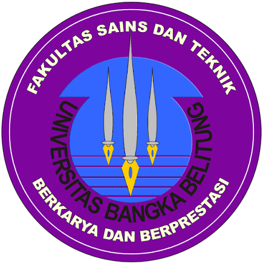
  </a>
  &nbsp;&nbsp;&nbsp;&nbsp;&nbsp;&nbsp;&nbsp;&nbsp;&nbsp;&nbsp;&nbsp;&nbsp;
  <a href="https://elektro.ubb.ac.id/" target="_blank" rel="noopener noreferrer">
    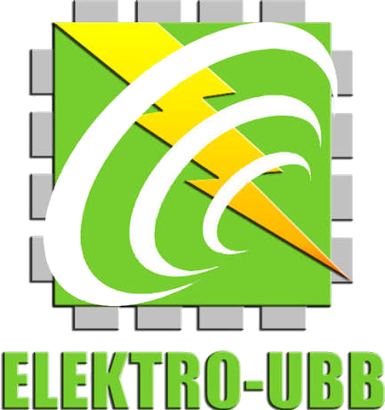
  </a>
</p>

<p align="center">
  <strong>UNIVERSITAS BANGKA BELITUNG</strong><br>
  <strong>FAKULTAS SAINS DAN TEKNIK &bull; JURUSAN TEKNIK ELEKTRO</strong><br>
  <em>Tim Robotika Selam Otonom AUV SAUVAC — Kualifikasi Singapore AUV Challenge (SAUVC) 2027</em>
</p>

<p align="center">
  
</p>

<p align="center">
  <a href="https://platformio.org/"></a>
  <a href="./PANDUAN_TERMINAL_AUV.md"></a>
  <a href="https://sauvc.org/"></a>
  <a href="https://ubb.ac.id/"></a>
  
  
  
  
</p>

---

## 📑 Daftar Isi
1. [Ringkasan Eksekutif & Profil Robot](#1-ringkasan-eksekutif-profil-robot)
2. [Showcase Model 3D CAD & Galeri Rancang Bangun Fisik](#2-showcase-model-3d-cad-galeri-rancang-bangun-fisik)
3. [Fitur Unggulan Firmware Versi 1.0](#3-fitur-unggulan-firmware-versi-10)
4. [Arsitektur Firmware & Dual-Core Multitasking Engine (RP2040)](#4-arsitektur-firmware-dual-core-multitasking-engine-rp2040)
5. [Tata Letak Fisik & Diagram Vektor 6 Thruster V6](#5-tata-letak-fisik-diagram-vektor-6-thruster-v6)
6. [Finite State Machine Misi Otonom SAUVC 2027](#6-finite-state-machine-misi-otonom-sauvc-2027)
7. [Bus Sensor I2C1, Pinout & Skema Keselamatan Kelistrikan](#7-bus-sensor-i2c1-pinout-skema-keselamatan-kelistrikan)
8. [Antarmuka Nirkabel: Web Terminal & OTA Flasher](#8-antarmuka-nirkabel-web-terminal-ota-flasher)
9. [Kamus Cepat Perintah Baris (Unified CLI Engine v1.0)](#9-kamus-cepat-perintah-baris-unified-cli-engine-v10)
10. [Panduan Kompilasi, Flashing USB & OTA (PlatformIO)](#10-panduan-kompilasi-flashing-usb-ota-platformio)
11. [Dokumen Teknis Terkait & Pedoman Standar UBB](#11-dokumen-teknis-terkait-pedoman-standar-ubb)

---

## 1. Ringkasan Eksekutif & Profil Robot

**AUV SAUVAC** (*Autonomous Underwater Vehicle - Robot Selam Otonom Universitas Bangka Belitung*) adalah platform robot selam nirawak otonom yang dikembangkan secara komprehensif oleh mahasiswa dan dosen **Jurusan Teknik Elektro, Fakultas Sains dan Teknik, Universitas Bangka Belitung (UBB)**. Robot ini dirancang khusus untuk memenuhi seluruh regulasi teknis dan kriteria penilaian kualifikasi kompetisi internasional bergengsi **Singapore AUV Challenge (SAUVC) 2027** di Singapore Polytechnic.

Robot beroperasi secara otonom penuh (*untethered autonomous*) di bawah permukaan air tanpa kabel kendali, mengandalkan komputasi terdistribusi **Raspberry Pi Pico W (RP2040)** dengan arsitektur dual-core asinkron:
- **Navigasi & Vektor Gerak:** Mengendalikan 6 unit pendorong *brushless* (4 pendorong horisontal pola vektor X 45° dan 2 pendorong vertikal pada lambung tengah) dengan matriks mixer 6 Derajat Kebebasan (*Degrees of Freedom* - 6-DOF).
- **Sistem Instrumentasi & Sensor:** Integrasi sensor tekanan kedalaman resolusi tinggi **MS5803-14BA**, sensor inersia 6 sumbu **MPU-6050**, dan kompas digital 3 sumbu **HMC5883L / QMC5883L** pada bus non-blocking I2C1 (`Wire1`).
- **Konektivitas & Telemetri Mandiri:** Memancarkan Wi-Fi SoftAP mandiri yang melayani **Web Terminal Console interaktif** dan fitur **OTA (Over-The-Air) Firmware Update**, memungkinkan pembaruan program firmware dan kalibrasi parameter tanpa perlu membongkar tabung kedap air (*hull*).
- **Kepatuhan Regulasi Kualifikasi SAUVC 2027 (Bebas Rintangan):** Siklus video kualifikasi berlangsung selama 40–45 detik tanpa rintangan (*open water trial*) mencakup kalibrasi nol otomatis (*surface tare*), penyelaman stabil 50 cm, pelayaran lurus, pengereman aktif (*active braking*), putaran haluan 180° searah jarum jam (*closed-loop yaw*), pelayaran kembali ke titik awal, mengapung aman di permukaan, serta pengujian pemutusan daya sakelar *hardware kill switch* di dalam air.

---

## 2. Showcase Model 3D CAD & Galeri Rancang Bangun Fisik

Konstruksi mekanis AUV SAUVAC dirancang kokoh tanpa menggunakan rangka aluminium (*no aluminum frame*) guna mengeliminasi risiko korosi air tawar/asin dan mencegah distorsi magnetik terhadap sensor kompas. Struktur fisik robot dibangun menggunakan kombinasi presisi **Plat Akrilik Bening (*Cast Acrylic Plates*)**, **Batang Pipa Struktural (*Structural Pipe Rods/Tubes*)**, dan **Kotak Kompartemen Kedap Air (*Waterproof Module Enclosure Boxes*)** berstandar IP68 yang memisahkan kompartemen baterai daya, instrumentasi sensor, dan unit komputasi (Raspberry Pi Pico W & Raspberry Pi 5 Companion Computer) yang diuji hingga kedalaman 10 meter.

<p align="center">
  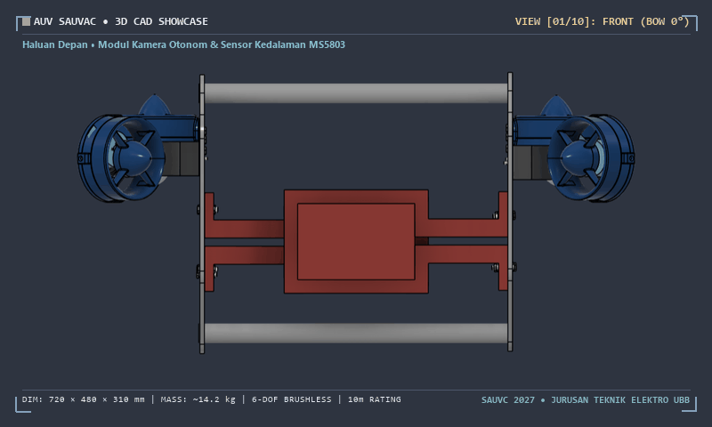
</p>
<p align="center">
  <em>Gambar 1: Animasi Turntable 3D CAD AUV SAUVAC (10 Sudut Pandang Transisi Halus dengan HUD Telemetri Rekayasa)</em>
</p>

### Galeri Rancang Bangun 3D CAD (10 Sudut Pandang)

Berikut dokumentasi komprehensif model rancang bangun robot dari seluruh proyeksi teknis:

<table align="center" width="100%">
  <tr>
    <td align="center" width="33%">
      <a href="docs/assets/cad/cad_01_front.png" target="_blank">
        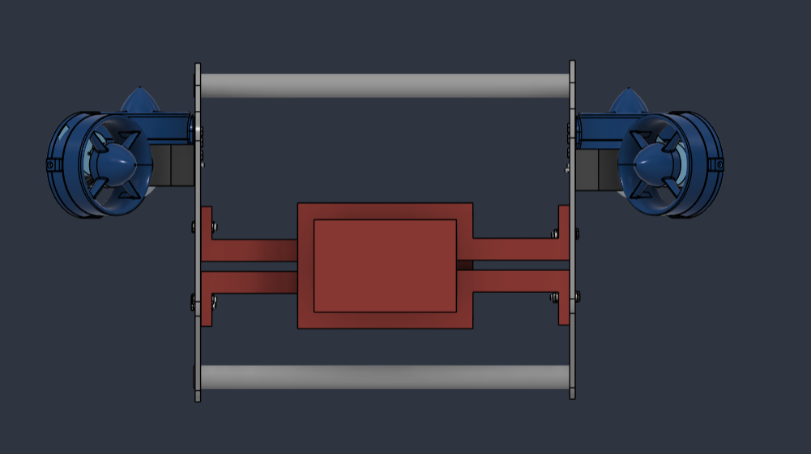
      </a>
      <br><strong>01. Haluan Depan (Bow 0°)</strong><br>
      <small>Kubah dome optik kamera visi otonom, penempatan sensor kedalaman MS5803, dan port LED navigasi.</small>
    </td>
    <td align="center" width="33%">
      <a href="docs/assets/cad/cad_02_iso_right.png" target="_blank">
        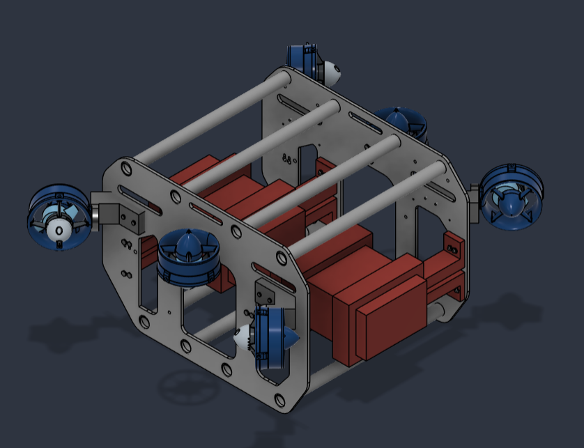
      </a>
      <br><strong>02. Isometrik Kanan Atas (45°)</strong><br>
      <small>Orientasi pendorong horisontal T2 (45°), pendorong vertikal T5, dan braket penopang silinder baterai.</small>
    </td>
    <td align="center" width="33%">
      <a href="docs/assets/cad/cad_03_side_right.png" target="_blank">
        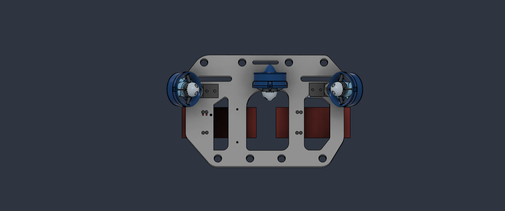
      </a>
      <br><strong>03. Lambung Kanan (Starboard 90°)</strong><br>
      <small>Profil samping tabung silinder daya baterai, rel pelindung lateral, dan perutean kabel ESC.</small>
    </td>
  </tr>
  <tr>
    <td align="center" width="33%">
      <a href="docs/assets/cad/cad_04_bottom_right.png" target="_blank">
        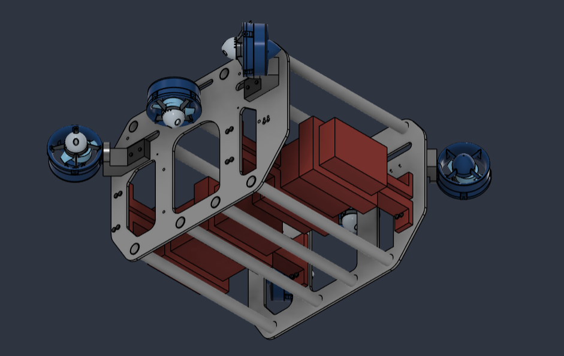
      </a>
      <br><strong>04. Isometrik Bawah Kanan (135°)</strong><br>
      <small>Dudukan balas timbal hidrostatik bawah dan klem penjepit tabung silinder kedap ganda.</small>
    </td>
    <td align="center" width="33%">
      <a href="docs/assets/cad/cad_05_rear.png" target="_blank">
        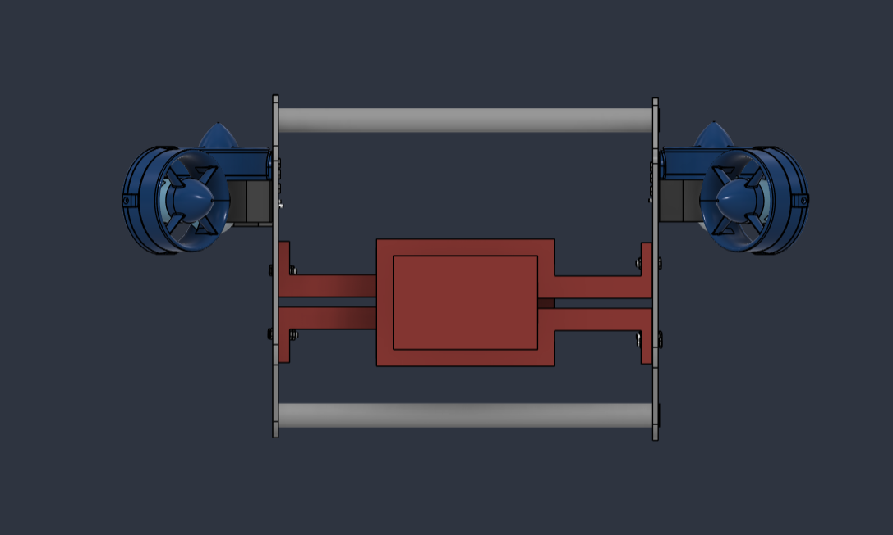
      </a>
      <br><strong>05. Buritan Belakang (Stern 180°)</strong><br>
      <small>Pendorong horisontal buritan T1 & T4, penetrator kabel kedap IP68, dan dudukan hardware kill switch.</small>
    </td>
    <td align="center" width="33%">
      <a href="docs/assets/cad/cad_06_bottom_left.png" target="_blank">
        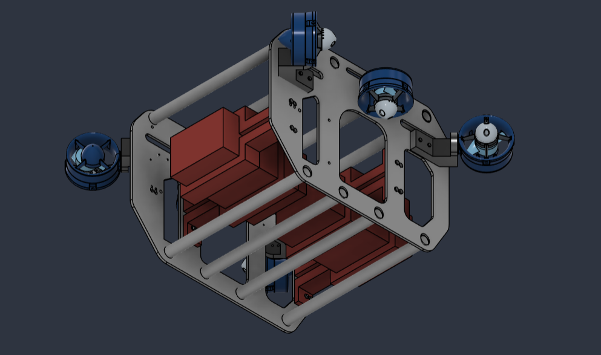
      </a>
      <br><strong>06. Isometrik Bawah Kiri (225°)</strong><br>
      <small>Geometri lunas pelindung (*keel*), distribusi berat Center of Gravity, dan skid pendaratan dasar kolam.</small>
    </td>
  </tr>
  <tr>
    <td align="center" width="33%">
      <a href="docs/assets/cad/cad_07_side_left.png" target="_blank">
        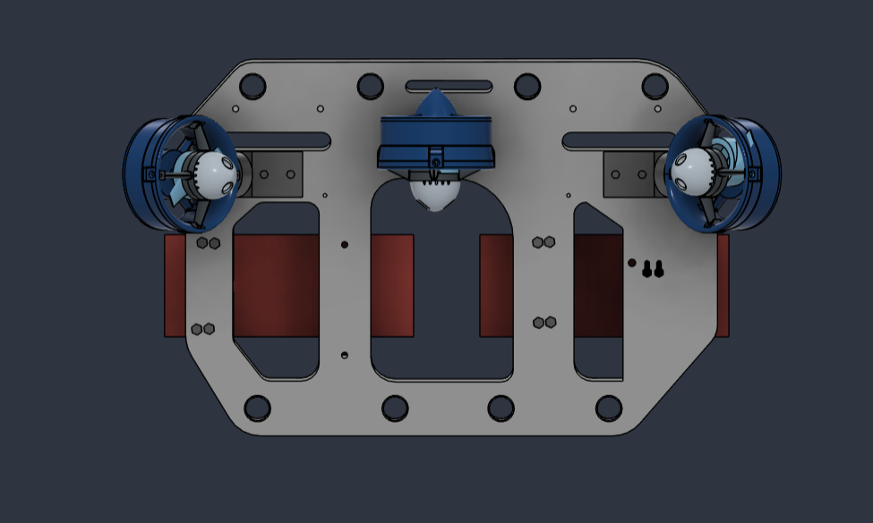
      </a>
      <br><strong>07. Lambung Kiri (Port 270°)</strong><br>
      <small>Profil samping tabung komputasi Pico W, pendorong vertikal lambung kiri T6, dan port switch kedap.</small>
    </td>
    <td align="center" width="33%">
      <a href="docs/assets/cad/cad_08_iso_left.png" target="_blank">
        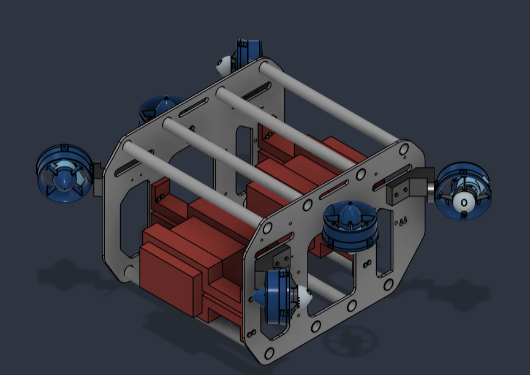
      </a>
      <br><strong>08. Isometrik Kiri Atas (315°)</strong><br>
      <small>Vektor pendorong depan kiri T3 (CCW), jalur sensor bus I2C, dan modul step-down regulator.</small>
    </td>
    <td align="center" width="33%">
      <a href="docs/assets/cad/cad_09_top.png" target="_blank">
        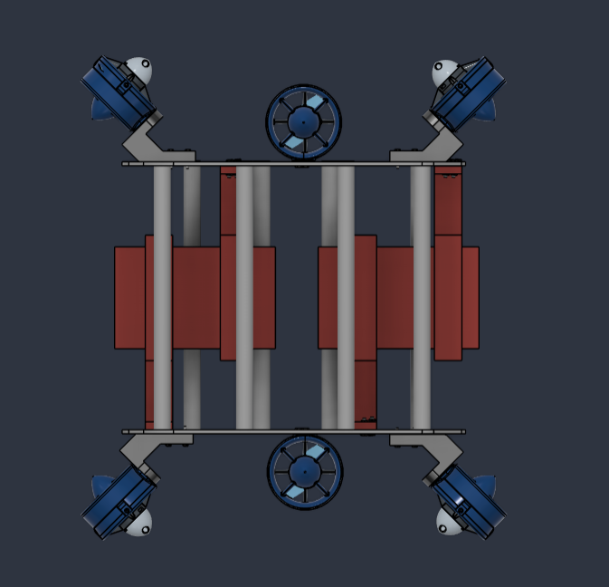
      </a>
      <br><strong>09. Tampak Atas (Top Plan View)</strong><br>
      <small>Simetri 4 pendorong horisontal vektor 45° pola-X (T1–T4) dan 2 pendorong vertikal pusat lambung (T5 & T6).</small>
    </td>
  </tr>
  <tr>
    <td align="center" colspan="3">
      <a href="docs/assets/cad/cad_10_bottom.png" target="_blank">
        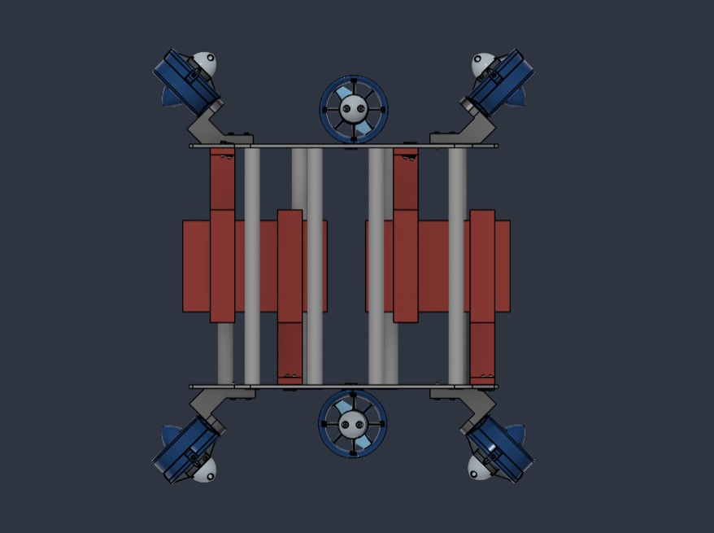
      </a>
      <br><strong>10. Tampak Bawah (Bottom Keel View)</strong><br>
      <small>Rangka pelindung benturan dasar kolam, pelat landasan operasional, dan kompartemen balas timbal.</small>
    </td>
  </tr>
</table>

> 📥 **Unduh File Asli 3D CAD:**  
> Berkas CAD solid 3D beresolusi tinggi tersedia di repositori:  
> **[`Dsains 3D & Gambar Dsains/Dsains SAUVC.stl`](./Dsains%203D%20%26%20Gambar%20Dsains/Dsains%20SAUVC.stl)** *(Ukuran: 19.8 MB, 396.660 Poligon STL Solid)*.

---

## 3. Fitur Unggulan Firmware Versi 1.0

1. **Dual-Core Asynchronous Engine (RP2040):**
   - **Core 0:** Mengeksekusi Web Terminal Server HTTP (Port 80), antarmuka REST API, parser Unified CLI Engine, ring-buffer event audit logger, finite state machine misi otonom, heartbeat watchdog (600 ms), matriks mixer kendali 6-DOF, dan pembangkit pulsa PWM perangkat keras 50 Hz.
   - **Core 1:** Melakukan polling sensor I2C1 (50 ms) secara non-blocking dengan sistem penanganan galat mandiri (*auto-reconnect*) jika jalur komunikasi terganggu derau listrik (*electrical noise*).
2. **Unified CLI Engine & Ring-Buffer Event Logger:**
   - Sintaks baris perintah terpadu yang 100% identik antara Web Terminal Wi-Fi dan USB Serial Monitor (115200 baud).
   - Log audit berkapasitas 80 entri dengan stempel waktu presisi milidetik yang dapat diunduh langsung (*dump*) untuk evaluasi komite juri kompetisi.
3. **Pembaruan Firmware Nirkabel (OTA Flasher):**
   - Mengunggah berkas biner `.bin` atau `.bin.signed` langsung melalui antarmuka peramban di endpoint `/update`.
   - Mengeliminasi kebutuhan membuka tutup tabung akrilik (*hull*) berulang kali saat uji coba kolam, menjaga integritas segel *O-ring seal*.
4. **Kepatuhan Mutlak Regulasi Kualifikasi SAUVC 2027:**
   - Target durasi video kualifikasi presisi **40 hingga 45 detik**.
   - Pelayaran otonom tanpa kabel (*untethered swim*) **$\ge$ 20 detik** di lintasan bebas rintangan (menyelam stabil, meluncur lurus, putar balik 180° searah jarum jam, dan meluncur kembali).
   - Integrasi sakelar pemutus daya fisik di dalam air (*submerged hardware kill switch*).
   - Penahan kedalaman (*depth-hold PID*) presisi tinggi untuk menjaga robot tetap stabil melayang tanpa menyentuh dasar kolam.
5. **Kompensasi Putaran Mundur Digital (`rev_boost`):**
   - Algoritma pengali dorongan mundur digital untuk menyeimbangkan asimetri karakteristik ESC *bidirectional* dan geometri hidrodinamika baling-baling.
6. **Mode Simulasi Meja / Laboratorium (`sim on`):**
   - Mode pengujian menyeluruh urutan misi otonom di atas meja kerja: sensor kedalaman divirtualisasikan dan batas daya motor dibatasi secara ketat **maksimal 3%** demi keselamatan kru darat.
7. **Pre-Flight Hardware Self-Test (`/selftest`):**
   - Uji diagnostik mandiri menyeluruh sebelum peluncuran yang memverifikasi sensor I2C (MS5803, MPU-6050, Kompas), memori EEPROM v1.0 & LittleFS, Wi-Fi SoftAP, serta pengujian pulsa lembut 0.2 detik pada motor T1–T6 dengan laporan ASCII PASS/FAIL.
8. **Underwater Blackbox CSV Flight Recorder (`/blackbox`):**
   - Perekam data penerbangan bawah air otomatis berfrekuensi 10Hz ke penyimpanan flash LittleFS (`/blackbox.csv`) mencakup kedalaman, roll, pitch, yaw, koordinat odometri X/Y, dan pulsa 6 motor. Berkas dapat diunduh langsung via tombol Web Console atau endpoint `/api/blackbox/download`.
9. **Raspberry Pi 5 Companion Computer Bridge (`/stream on/off`):**
   - Jembatan komunikasi telemetri kecepatan tinggi 20Hz structured JSON via USB Serial untuk integrasi komputasi visi otonom dan navigasi cerdas pada Raspberry Pi 5.
10. **Underwater Dead-Reckoning Odometry (Koordinat X, Y, Z Kolam):**
    - Estimasi posisi real-time robot di dalam kolam ($X = \text{maju}$, $Y = \text{lateral drift}$, $Z = \text{kedalaman}$) dihitung melalui integrasi proyeksi vektor kecepatan maju terhadap sudut haluan.
11. **Mini Artificial Horizon & Compass HUD di Web Console:**
    - Panel instrumen visual interaktif berbasis SVG murni yang menampilkan indikator horizon pitch/roll dan jarum kompas dinamis tanpa library eksternal.

---

## 4. Arsitektur Firmware & Dual-Core Multitasking Engine (RP2040)

Mikrokontroler RP2040 menjalankan firmware dengan pembagian beban kerja paralel menggunakan proteksi memori *critical section mutex*:

```text
┌────────────────────────────────────────────────────────────────────────┐
│                        RP2040 CORE 0 (Utama)                           │
│  - Web Terminal Server HTTP Port 80 (REST API & Command Console)       │
│  - Unified CLI Engine (Parser baris perintah Serial USB & Web)         │
│  - Ring-Buffer Event Logger (80 entri riwayat audit dengan timestamp)  │
│  - Finite State Machine Misi Otonom SAUVC (Dive -> Cruise -> Turn)     │
│  - Watchdog Keselamatan & Heartbeat Failsafe (Batas 600 ms)            │
│  - Matriks Mixer Kendali 6-DOF (Surge, Sway, Heave, Yaw, Pitch, Roll)  │
│  - Pembangkit Pulsa PWM Servo Hardware (50 Hz, GP2 s.d. GP7)           │
│  - Layanan Pembaruan Firmware Nirkabel (OTA Flasher via /update)       │
└────────────────────────────────────────────────────────────────────────┘
                                    │
       [ Snapshot Data Mutex & Atomics Non-Blocking Memory Order ]
                                    │
┌────────────────────────────────────────────────────────────────────────┐
│                        RP2040 CORE 1 (Sensor)                          │
│  - Polling Sensor I2C1 (Wire1: GP26 SDA / GP27 SCL) setiap 50 ms       │
│  - Pembacaan Sensor Tekanan MS5803-14BA (Kedalaman air presisi mm)     │
│  - Filter Digital Moving Average (Peredam riak gelombang permukaan)    │
│  - Pembacaan IMU 6-DOF MPU-6050 & Filter Komplementer Orientasi Sudut  │
│  - Kompas Magnetik HMC5883L/QMC5883L & Koreksi Deklinasi Magnetik      │
│  - Thread Watchdog & Auto-Reconnect Otomatis jika Bus I2C Mengalami Noise
└────────────────────────────────────────────────────────────────────────┘
```

> **Isolasi Hardware:** Pembacaan tegangan baterai ADC3 (GPIO29) diisolasi sepenuhnya dari jalur transfer paket Wi-Fi CYW43439 untuk mengeliminasi benturan bus dan penguncian sistem (*system lockup*).

---

## 5. Tata Letak Fisik & Diagram Vektor 6 Thruster V6

Robot menggunakan konfigurasi 6 unit pendorong *brushless* dengan tata letak geometris simetris: 4 pendorong horisontal pola vektor X 45° untuk gerak bidang datar (*surge, sway, yaw*) dan 2 pendorong vertikal pada lambung tengah untuk kendali daya apung dan kemiringan (*heave, roll*).

<p align="center">
  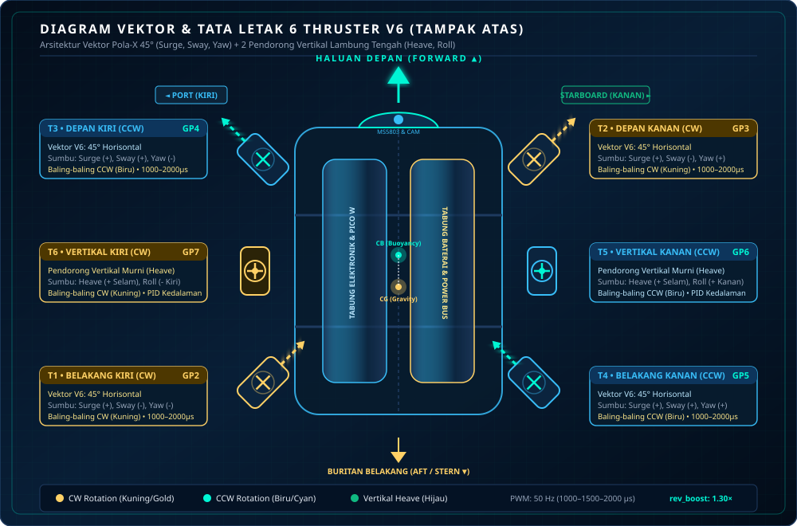
</p>
<p align="center">
  <em>Gambar 2: Diagram Vektor Gaya Dinamis & Tata Letak Fisik 6 Thruster V6 (Animasi Rotasi Baling-Baling & Vektor Dorong)</em>
</p>

### A. Tabel Konfigurasi Jalur GPIO & Motor
| Motor | Posisi Fisik | Rotasi Acuan | GPIO Pico W | Sinyal PWM | Pulsa Netral | Pulsa Min – Max | Sumbu Gerakan Primer |
| :---: | :--- | :---: | :---: | :---: | :---: | :---: | :--- |
| **T1** | Belakang Kiri (*Aft Port*) | CW (Kuning) | **GP2** | 50 Hz | 1500 µs | 1000 – 2000 µs | Surge (+), Sway (-), Yaw (-) |
| **T2** | Depan Kanan (*Bow Starboard*) | CW (Kuning) | **GP3** | 50 Hz | 1500 µs | 1000 – 2000 µs | Surge (+), Sway (-), Yaw (+) |
| **T3** | Depan Kiri (*Bow Port*) | CCW (Biru) | **GP4** | 50 Hz | 1500 µs | 1000 – 2000 µs | Surge (+), Sway (+), Yaw (-) |
| **T4** | Belakang Kanan (*Aft Starboard*)| CCW (Biru) | **GP5** | 50 Hz | 1500 µs | 1000 – 2000 µs | Surge (+), Sway (+), Yaw (+) |
| **T5** | Lambung Kanan Vertikal | CW (Hijau) | **GP6** | 50 Hz | 1500 µs | 1000 – 2000 µs | Heave (+ Selam), Roll (+ Kanan) |
| **T6** | Lambung Kiri Vertikal | CCW (Hijau) | **GP7** | 50 Hz | 1500 µs | 1000 – 2000 µs | Heave (+ Selam), Roll (- Kiri) |

> 💡 **Parameter Inversi Digital (`reverse`):**  
> Setiap motor T1 hingga T6 mendukung pembalikan arah rotasi digital via terminal: `thruster <id> reverse <0/1>` (0 = rotasi normal, 1 = arah terbalik) lalu `save` ke EEPROM. Fitur ini memungkinkan penyesuaian arah dorongan langsung dari poolside tanpa membuka kompartemen untuk menukar kabel 3-fase motor.

### B. Matriks Pembobotan Mixer 6-DOF
Matriks alokasi gaya mengonversi perintah 6 sumbu menjadi pulsa keluaran aktuator:

$$\begin{bmatrix} T_1 \\ T_2 \\ T_3 \\ T_4 \\ T_5 \\ T_6 \end{bmatrix} = \begin{bmatrix} +1.0 & -1.0 & 0.0 & -1.0 & 0.0 & 0.0 \\ +1.0 & -1.0 & 0.0 & +1.0 & 0.0 & 0.0 \\ +1.0 & +1.0 & 0.0 & -1.0 & 0.0 & 0.0 \\ +1.0 & +1.0 & 0.0 & +1.0 & 0.0 & 0.0 \\ 0.0 & 0.0 & +1.0 & 0.0 & 0.0 & +1.0 \\ 0.0 & 0.0 & +1.0 & 0.0 & 0.0 & -1.0 \end{bmatrix} \begin{bmatrix} \text{Surge (Maju)} \\ \text{Sway (Geser)} \\ \text{Heave (Selam)} \\ \text{Yaw (Putar)} \\ \text{Pitch (Angkat)} \\ \text{Roll (Miring)} \end{bmatrix}$$

---

## 6. Finite State Machine Misi Otonom SAUVC 2027

Urutan misi otonom dirancang khusus untuk memenuhi kualifikasi resmi SAUVC dengan batas video 40–45 detik dan pelayaran otonom $\ge 20$ detik:

<p align="center">
  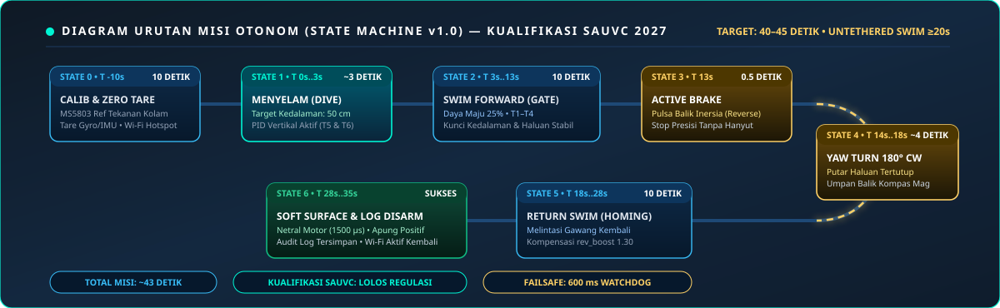
</p>
<p align="center">
  <em>Gambar 3: Diagram Alur Finite State Machine Misi Otonom v1.0 Kualifikasi SAUVC 2027</em>
</p>

### Rincian Tahapan Misi Detik Demi Detik:
1. **State 0: Boot & Surface Calibration (10 Detik):** Robot mengambang di permukaan air. Sensor MS5803 melakukan pembacaan 200 sampel tekanan atmosfer untuk mengunci titik nol air (*surface tare*). Kalibrasi bias giroskop IMU dilakukan dan nada konfirmasi bip ESC berbunyi.
2. **State 1: Descent / Menyelam ke 50 cm (~3 Detik):** Pendorong vertikal T5 dan T6 berputar aktif di bawah kendali loop tertutup (*closed-loop PID*) membawa robot menyelam hingga kedalaman 50 cm dengan toleransi $\pm 2$ cm.
3. **State 2: Swim Forward / Meluncur Lurus (10 Detik):** Keempat pendorong horisontal T1–T4 menyemburkan daya dorong maju 25%. Kontroler PID kedalaman dan kompas tetap aktif mengunci orientasi lintasan lurus bebas rintangan tanpa menyentuh dasar kolam.
4. **State 3: Active Brake / Pengereman Dinamis (0.5 Detik):** Algoritma membalikkan vektor horisontal sejenak untuk meniadakan inersia maju, menghentikan robot secara presisi di titik putar tanpa hanyut.
5. **State 4: Yaw Turn 180° CW (~4 Detik):** Robot berputar di tempat sebesar 180° searah jarum jam (*clockwise*) dipandu pembacaan kompas magnetometer hingga menghadap kembali ke titik awal.
6. **State 5: Return Swim / Berenang Pulang (10 Detik):** Meluncur lurus kembali menuju zona keberangkatan dengan kompensasi putaran mundur `rev_boost 1.30`.
7. **State 6: Soft Surface & Mission Completed (~5 Detik):** Pulsa seluruh motor dinetralkan ke 1500 µs. Gaya apung positif alami membawa robot naik dengan tenang ke permukaan air. Hotspot Wi-Fi SoftAP diaktifkan kembali dan berkas log audit tersimpan di memori.

---

## 7. Bus Sensor I2C1, Pinout & Skema Keselamatan Kelistrikan

Semua modul instrumentasi sensor terhubung paralel pada bus **I2C1 (`Wire1`)** Raspberry Pi Pico W:

| Perangkat / Sensor | Fungsi Utama | Alamat I2C | Pin SDA | Pin SCL | Catu Daya |
| :--- | :--- | :---: | :---: | :---: | :---: |
| **MS5803-14BA** | Tekanan Air & Estimasi Kedalaman Presisi | `0x76` (alt `0x77`) | **GP26** | **GP27** | **3V3 OUT (Pin 36)** |
| **MPU-6050** | IMU 6-DOF (Akselerometer & Giroskop) | `0x68` (alt `0x69`) | **GP26** | **GP27** | **3V3 OUT (Pin 36)** |
| **HMC5883L / QMC5883L**| Kompas Digital 3-Sumbu (Heading Haluan) | `0x1E` / `0x0D` | **GP26** | **GP27** | **3V3 OUT (Pin 36)** |
| **Monitor Baterai** | Pengukur Tegangan Baterai Bus VSYS | Internal ADC3 | - | - | **GPIO29 (Pin 34)** |

```text
       ┌────────────────────────────────────────────────────────┐
       │                Raspberry Pi Pico W                     │
       │                                                        │
       │  GP2  ─────────► Sinyal PWM Motor T1 (Belakang Kiri)   │
       │  GP3  ─────────► Sinyal PWM Motor T2 (Depan Kanan)     │
       │  GP4  ─────────► Sinyal PWM Motor T3 (Depan Kiri)      │
       │  GP5  ─────────► Sinyal PWM Motor T4 (Belakang Kanan)  │
       │  GP6  ─────────► Sinyal PWM Motor T5 (Vertikal Kanan)  │
       │  GP7  ─────────► Sinyal PWM Motor T6 (Vertikal Kiri)   │
       │                                                        │
       │  GP26 ─────────► I2C1 SDA (Sensor MS5803, MPU, Kompas) │
       │  GP27 ─────────► I2C1 SCL (Sensor MS5803, MPU, Kompas) │
       │  3V3  ─────────► VCC Modul Sensor (MAKSIMAL 3.3V!)     │
       │  GND  ─────────► Common Ground (Baterai, ESC, Sensor)  │
       └────────────────────────────────────────────────────────┘
```

> ⚠️ **STANDAR KESELAMATAN KELISTRIKAN:**
> 1. **Tegangan Logika Sensor:** Kaki VCC modul sensor **WAJIB** terhubung ke pin **3V3 (Pin 36)** Pico W. Dilarang keras menghubungkan sensor ke tegangan 5V (VBUS).
> 2. **Common Ground:** Seluruh kutub negatif baterai utama, regulator step-down buck, ESC motor, modul sensor, dan Pico W wajib disatukan (*Common Ground*).
> 3. **Hardware Kill Switch:** Sakelar fisik pemutus arus darurat dipasang pada bagian luar lambung buritan untuk memutus sirkuit daya utama secara mekanis saat ditarik atau ditekan oleh penyelam di dalam air.

---

## 8. Antarmuka Nirkabel: Web Terminal & OTA Flasher

Pico W secara otomatis mengaktifkan hotspot nirkabel mandiri tanpa membutuhkan router eksternal:
- **Nama Jaringan (SSID):** `AUV_UBB_JUARA`
- **Kata Sandi Wi-Fi:** `ubbjuara2027` (WPA2-PSK)
- **Alamat Dasbor:** `http://192.168.4.1`
- **Keamanan Web Console:** Langsung terbuka seketika tanpa pop-up login (Keamanan jaringan dilindungi penuh oleh WPA2-PSK Wi-Fi).

### Fitur Antarmuka Dasbor Web:
1. **Telemetry Bar Real-Time:** Menampilkan data langsung kedalaman (cm), heading kompas (°), orientasi roll/pitch (°), tegangan VSYS (V), batas daya (%), dan status sistem (ARMED/DISARM).
2. **Tombol Cepat Lapangan:** Tombol kendali satu sentuhan `[RUN MISSION]`, `[STOP DARURAT]`, `[CALIB ZERO]`, dan `[DOWNLOAD AUDIT LOG]`.
3. **Web Terminal Console:** Konsol interaktif dengan penyorotan sintaks (*syntax highlighting*) dan riwayat perintah tombol panah atas/bawah.
4. **OTA Firmware Flasher:** Antarmuka unggah berkas biner firmware (`.bin` / `.bin.signed`) nirkabel dengan bilah status kemajuan persentase (*progress bar*).

---

## 9. Kamus Cepat Perintah Baris (Unified CLI Engine v1.0)

Sistem merespons perintah yang sama baik melalui Web Terminal Wi-Fi maupun USB Serial Monitor (115200 baud, baris diakhiri `CR/LF`):

| Perintah Baris | Deskripsi Singkat & Fungsi | Nilai Default / Rentang |
| :--- | :--- | :--- |
| `run` | Memulai eksekusi urutan misi otonom SAUVC. | - |
| `stop` | **Stop darurat seketika:** Netralkan semua motor ke 1500 µs & DISARM. | - |
| `status` | Menampilkan laporan lengkap telemetri, baterai, sensor, dan status misi. | - |
| `depth <cm>` | Mengatur target kedalaman penyelaman misi (misal `depth 50`). | 0 – 500 cm (Default: `50`) |
| `swim <detik>` | Mengatur durasi meluncur maju & kembali (misal `swim 10`). | 1 – 120 detik (Default: `10`) |
| `power <%>` | Mengatur batas plafon daya motor sistem (misal `power 25`). | 5 – 100 % (Default: `25`) |
| `rev_boost <faktor>`| Faktor kompensasi dorongan mundur digital (misal `rev_boost 1.3`). | 1.00 – 2.50 (Default: `1.30`) |
| `autorun <on/off>`| Mengaktifkan peluncuran misi otomatis 10 detik pasca-boot. | on / off (Default: `on`) |
| `calib zero` | Menolkan referensi tekanan sensor kedalaman di permukaan air. | - |
| `calib ballast`| Mengukur gaya apung vertikal dan menyimpannya ke `heave_bias`. | - |
| `sim <on/off>` | Mengaktifkan mode simulasi meja (kedalaman virtual, daya aman 3%). | on / off (Default: `off`) |
| `test motor <id> <%|pwm>` | Memutar satu motor selama 2 detik untuk verifikasi arah fisik. | Motor Id: 1 s.d. 6 |
| `log dump` | Menampilkan rekaman seluruh peristiwa audit dengan stempel waktu. | Maks 80 entri |
| `save` | Menyimpan seluruh perubahan parameter dari RAM ke EEPROM permanen. | - |
| `reboot` | Memulai ulang mikrokontroler Raspberry Pi Pico W secara halus. | - |

> *Panduan rinci seluruh parameter lanjutan, sintaks lengkap, dan penyetelan PID tersedia di:* **[PANDUAN_TERMINAL_AUV.md](./PANDUAN_TERMINAL_AUV.md)**.

---

## 10. Panduan Kompilasi, Flashing USB & OTA (PlatformIO)

Proyek ini dibangun menggunakan **PlatformIO Core (CLI)** dengan lingkungan `picow` (framework Arduino-Pico Earle Philhower Core).

### 📦 Berkas Rilis Siap Pakai (Precompiled Binaries v1.0)
Untuk kemudahan pengujian tanpa perlu mengompilasi dari kode sumber, berkas biner resmi **Firmware v1.0 Autonomous** telah disediakan langsung di dalam repositori:

| Berkas Biner | Ukuran | Metode Penggunaan Utama | Tautan Unduh Langsung |
| :--- | :---: | :--- | :--- |
| **`firmware_v1.0.uf2`** | ~1.0 MB | **Metode 1:** Drag-and-drop via USB BOOTSEL (Kondisi board baru/kosong) | 📥 [**Unduh firmware_v1.0.uf2**](./firmware/v1.0/firmware_v1.0.uf2) |
| **`firmware_v1.0.bin`** | ~515 KB | **Metode 2:** Wireless OTA Flasher via Web Terminal (Tanpa bongkar hull) | 📥 [**Unduh firmware_v1.0.bin**](./firmware/v1.0/firmware_v1.0.bin) |

> 📖 *Petunjuk ringkas dan panduan verifikasi checksum biner tersedia pada:* [**`firmware/v1.0/README.md`**](./firmware/v1.0/README.md).

---

### 3 Metode Flashing Firmware:

#### Metode 1: Flashing Awal via USB (BOOTSEL Drag-and-Drop)
*Metode tercepat untuk board Raspberry Pi Pico W baru atau saat pemulihan sistem (recovery):*
1. Tahan tombol fisik **BOOTSEL** berwarna putih pada board Raspberry Pi Pico W.
2. Sambil menahan tombol, tancapkan kabel micro-USB dari Pico W ke port USB komputer/laptop. Lepaskan tombol BOOTSEL setelah terhubung.
3. Komputer akan mendeteksi Pico W sebagai media penyimpanan massal USB (*USB Mass Storage Drive*) bernama **`RPI-RP2`**.
4. Salin (*drag-and-drop* atau *copy-paste*) berkas [**`firmware/v1.0/firmware_v1.0.uf2`**](./firmware/v1.0/firmware_v1.0.uf2) langsung ke dalam drive `RPI-RP2`.
5. Drive `RPI-RP2` akan otomatis terputus (*unmount*), mikrokontroler melakukan *reboot* mandiri, dan dalam waktu ~2 detik LED onboard akan berkedip menandakan hotspot Wi-Fi SoftAP `AUV_UBB_JUARA` telah aktif.

#### Metode 2: Flashing Nirkabel via OTA (Metode Utama di Kolam / Poolside)
*Metode operasional tanpa perlu membuka tabung kompartemen kedap air (hull), menjaga keawetan seal O-ring:*
1. Nyalakan AUV SAUVAC dan sambungkan koneksi Wi-Fi laptop atau smartphone ke hotspot **`AUV_UBB_JUARA`** (Password: `ubbjuara2027`).
2. Buka peramban web (*browser*) dan akses alamat IP default: **`http://192.168.4.1`**.
3. Klik tab **`📦 OTA Firmware Update`** pada antarmuka Web Terminal.
4. Klik tombol **Pilih Berkas Firmware** dan arahkan ke berkas [**`firmware/v1.0/firmware_v1.0.bin`**](./firmware/v1.0/firmware_v1.0.bin).
5. Klik **Flash Firmware Nirkabel**. Bilah kemajuan (*progress bar*) akan menampilkan status upload (0–100%).
6. Setelah upload selesai, mikrokontroler memverifikasi integritas flash, menerapkan pembaruan, dan me-reboot otomatis dalam < 5 detik.

#### Metode 3: Kompilasi & Flashing via PlatformIO Core CLI (USB Serial)
*Metode standar bagi pengembang untuk memodifikasi kode sumber dan langsung mengunggahnya:*
1. Sambungkan kabel micro-USB Pico W ke komputer tanpa menekan tombol BOOTSEL (koneksi USB CDC Serial).
2. Jalankan kompilasi sekaligus unggah firmware menggunakan PlatformIO CLI:
   ```bash
   # Kompilasi kode sumber
   pio run

   # Kompilasi dan upload otomatis via port serial USB
   pio run --target upload
   ```
3. Hasil kompilasi biner otomatis diproduksi dan diperbarui di direktori `.pio/build/picow/` (`firmware.bin` dan `firmware.uf2`).

---

## 11. Dokumen Teknis Terkait & Pedoman Standar UBB

Seluruh dokumentasi teknis dalam repositori ini disusun mengacu pada **Standar Format Dokumen Universitas Bangka Belitung**:

- 📖 **[PANDUAN_TERMINAL_AUV.md](./PANDUAN_TERMINAL_AUV.md)** — Buku manual komprehensif pengoperasian Web Terminal, Unified CLI Engine v1.0 (kamus 40+ perintah), SOP video kualifikasi SAUVC 2027, solusi motor mundur loyo (`rev_boost`), panduan simulasi meja kerja (`sim on`), dan tata cara pembaruan firmware nirkabel (OTA).

---

<p align="center">
  <strong>TIM ROBOTIKA AUV SAUVAC</strong><br>
  <strong>JURUSAN TEKNIK ELEKTRO &bull; FAKULTAS SAINS DAN TEKNIK</strong><br>
  <strong>UNIVERSITAS BANGKA BELITUNG</strong><br>
  <em>Kampus Terpadu UBB, Balunijuk, Merawang, Bangka, Kepulauan Bangka Belitung 33172</em><br>
  <em>"Maju Bersama Maritim Indonesia di Kancah Internasional — SAUVC 2027"</em>
</p>
