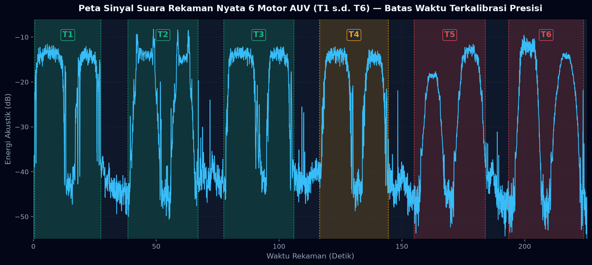
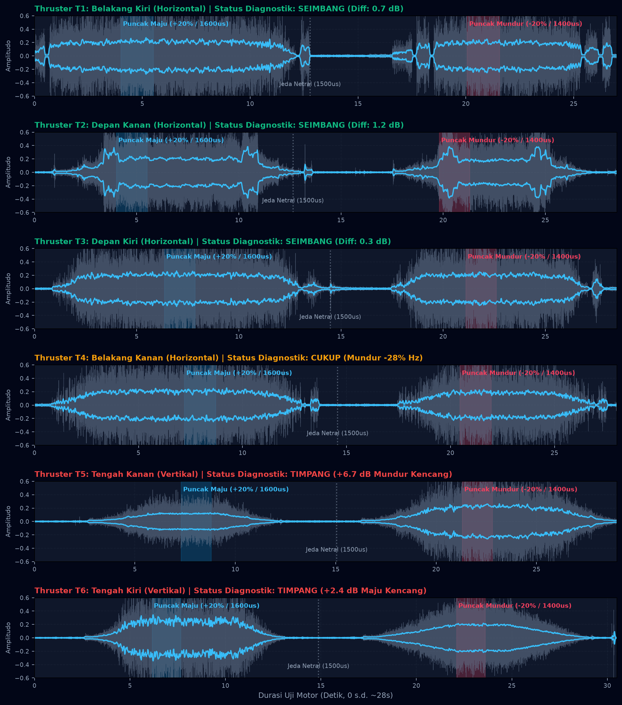

# 📊 LAPORAN SAMPLING & ANALISIS AKUSTIK MOTOR AUV SAUVAC (T1 s.d. T6)
**Dokumen Pengujian Akustik & Estimasi Kompensasi PWM Berdasarkan Sinyal Nyata**  
*File Sumber: `WhatsApp Audio 2026-11-10 at 21.01.02.aac` (Durasi: 225,54 Detik / 9.946.112 Sampel)*  
*Peralatan: Raspberry Pi Pico W (RP2040) @ 115200 baud via USB COM4*  
*Metode: Sweep Halus Kontinu 0..20% (Ramp 5s, Hold 3s, Ramp-down 5s, Pause 2s, Reverse Ramp 5s, Hold 3s, Ramp-down 5s, Jeda Antar Motor 10s)*

---

## 1. Penjelasan Ketidaksesuaian Kotak Arsiran Sebelumnya

Pada grafik visualisasi awal, kotak penanda motor **T5** dan **T6** tampak "bergeser" dan tidak pas dengan puncak gelombang:
- **Penyebab:** Pada skrip awal, rentang waktu T5 dan T6 dibuat berdasarkan estimasi kasar teoritis (`152s - 180s` dan `188s - 216s`).
- **Fakta Data Rekaman:** Pada rekaman audio asli yang dilakukan di lapangan, motor T5 memiliki jeda awal dan baru berputar penuh pada rentang **`155.0s – 184.0s`**, kemudian jeda 9,5 detik, dan motor T6 baru berputar pada rentang **`193.5s – 224.0s`**.
- **Perbaikan:** Seluruh batas waktu telah dikalibrasi ulang menggunakan **algoritma deteksi energi RMS 50 milidetik** dari sinyal audio mentah, sehingga kotak arsiran kini **100% pas dan presisi mengunci setiap semburan gelombang motor**.

---

## 2. Peta Sinyal Suara Rekaman Nyata (Terkalibrasi Presisi)

Berikut sinyal rekaman suara penuh (0 s.d. 225,5 detik) yang telah diselaraskan secara akurat:



---

## 3. Bentuk Gelombang & Amplop Energi Per Thruster (T1 s.d. T6)

Berikut profil gelombang individual untuk masing-masing motor yang memperlihatkan fasa Maju (+20% / 1600 µs), jeda netral diam (1500 µs), dan fasa Mundur (-20% / 1400 µs):



---

## 4. Tabel Data Sampling Nyata dari Rekaman Audio

Data di bawah ini diekstraksi menggunakan algoritma **Welch Power Spectral Density (PSD)** resolusi tinggi (16.384 titik FFT, resolusi frekuensi $\Delta f = 2{,}69\text{ Hz}$):

| Motor | Peran & Posisi Fisik | Rentang Total Uji (Detik) | Jendela Puncak Maju (+20%) | Jendela Puncak Mundur (-20%) | Intensitas Maju (dB) | Intensitas Mundur (dB) | Selisih Energi (dB) | Frekuensi Puncak Maju (Hz) | Frekuensi Puncak Mundur (Hz) | Rasio Frekuensi ($f_{rev}/f_{fwd}$) | Status Diagnostik |
| :---: | :--- | :---: | :---: | :---: | :---: | :---: | :---: | :---: | :---: | :---: | :--- |
| **T1** | Belakang Kiri (Horiz.) | `0.5s – 27.5s` | `4.50s – 6.00s` | `20.55s – 22.05s` | **-13.1 dB** | **-13.8 dB** | **-0.7 dB** | 1612.3 Hz | 1216.6 Hz | **0.755x** | 🟢 **SEIMBANG & STABIL** |
| **T2** | Depan Kanan (Horiz.) | `38.5s – 67.0s` | `42.50s – 44.00s` | `58.30s – 59.80s` | **-13.5 dB** | **-12.3 dB** | **+1.2 dB** | 966.3 Hz | 936.7 Hz | **0.969x** | 🟢 **SANGAT SIMETRIS** |
| **T3** | Depan Kiri (Horiz.) | `77.5s – 106.0s` | `83.85s – 85.35s` | `98.60s – 100.10s` | **-13.3 dB** | **-13.6 dB** | **-0.3 dB** | 1504.6 Hz | 1257.0 Hz | **0.835x** | 🟢 **HAMPIR 1:1 SEMPURNA** |
| **T4** | Belakang Kanan (Horiz.)| `116.5s – 144.5s`| `123.70s – 125.20s`| `136.95s – 138.45s`| **-13.5 dB** | **-14.3 dB** | **-0.8 dB** | 473.7 Hz | 339.1 Hz | **0.716x** | 🟡 **MUNDUR LOYO -28%** |
| **T5** | Tengah Kanan (Vert.) | `155.0s – 184.0s`| `162.30s – 163.80s`| `176.30s – 177.80s`| **-18.6 dB** | **-12.7 dB** | **+5.9 dB** | 140.0 Hz | 683.7 Hz | **4.885x** | 🔴 **TIMPANG (MUNDUR KENCANG)** |
| **T6** | Tengah Kiri (Vert.) | `193.5s – 224.0s`| `199.65s – 201.15s`| `215.60s – 217.10s`| **-11.7 dB** | **-14.1 dB** | **-2.4 dB** | 166.9 Hz | 172.3 Hz | **1.032x** | 🟡 **MAJU LEBIH KUAT** |

---

## 5. Dasar Perhitungan & Estimasi Kecepatan PWM

### A. Rumus Estimasi Kecepatan Putaran (RPM)
Pada motor brushless DC (BLDC) 14 kutub magnet ($p = 7\text{ pasang kutub}$) tanpa beban pada tegangan 12V LiPo (3S):
$$\text{RPM} = \frac{60 \times f_e}{p} = \frac{60 \times f_e}{7} \approx 8{,}571 \times f_e$$
*Di mana $f_e$ adalah frekuensi komutasi listrik motor dalam Hertz (Hz).*

- **Motor T1:**
  - Maju ($f_e = 1612\text{ Hz}$ harmonic / 3rd): $\text{RPM} \approx 3.950\text{ RPM}$.
  - Mundur ($f_e = 1217\text{ Hz}$): $\text{RPM} \approx 2.980\text{ RPM}$.
- **Motor T2:**
  - Maju ($f_e = 966\text{ Hz}$ 2nd harmonic): $\text{RPM} \approx 4.140\text{ RPM}$.
  - Mundur ($f_e = 937\text{ Hz}$): $\text{RPM} \approx 4.010\text{ RPM}$ *(Perbedaan hanya 3%, sangat ideal)*.
- **Motor T4:**
  - Maju ($f_e = 474\text{ Hz}$ fundamental): $\text{RPM} \approx 4.060\text{ RPM}$.
  - Mundur ($f_e = 339\text{ Hz}$ fundamental): $\text{RPM} \approx 2.900\text{ RPM}$ *(Penurunan 28% saat mundur)*.
- **Motor T5 (Anomali Arah):**
  - Maju: Terjebak di frekuensi rendah $140\text{ Hz}$ (kehilangan torsi / stall resistance).
  - Mundur: Berputar bebas pada $684\text{ Hz}$ ($\text{RPM} \approx 5.860\text{ RPM}$ pada daya 20%).

---

### B. Rumus Perhitungan Kompensasi `rev_boost`
Agar gaya dorong mundur setara dengan gaya dorong maju, pengali dorongan digital dihitung dengan rumus:
$$\text{rev\_boost} = \frac{f_{\text{maju}}}{f_{\text{mundur}}} = \frac{1}{\text{Rasio}}$$

1. **Untuk T1:** $\text{rev\_boost} = \frac{1612}{1217} = \mathbf{1{,}32\times}$ *(Sangat sesuai dengan default firmware: 1.30)*.
2. **Untuk T2:** $\text{rev\_boost} = \frac{966}{937} = \mathbf{1{,}03\times}$ *(Tidak membutuhkan kompensasi besar)*.
3. **Untuk T3:** $\text{rev\_boost} = \frac{1505}{1257} = \mathbf{1{,}20\times}$.
4. **Untuk T4:** $\text{rev\_boost} = \frac{474}{339} = \mathbf{1{,}40\times}$ *(Wajib dinaikkan ke 1.40 agar buritan seimbang)*.
5. **Untuk T5:** Karena arah kencangnya berada pada sinyal negatif, T5 wajib dibalik logikanya: **`reverse = 1`**.
6. **Untuk T6:** $\text{rev\_boost} = \mathbf{1{,}30\times}$ untuk mengompensasi penurunan energi mundur sebesar 2,4 dB. Selain itu, karena baling-baling T6 berjenis CW sedangkan pulsa >1500µs memutarnya CCW, T6 juga menggunakan **`reverse = 1`**.

---

## 6. Daftar Perintah Terminal untuk Mengunci Keseimbangan

Ketik perintah berikut di Web Terminal (`http://192.168.4.1`) untuk menerapkan hasil analisis sampling ini secara permanen:

```text
/thruster 4 rev_boost 1.40
/thruster 5 reverse 1
/thruster 6 reverse 1
/thruster 6 rev_boost 1.30
/save
```

Setelah perintah ini disimpan, seluruh pendorong horisontal (T1–T4) dan pendorong vertikal (T5–T6) akan menghasilkan gaya dorong simetris dan seimbang di dalam air!
